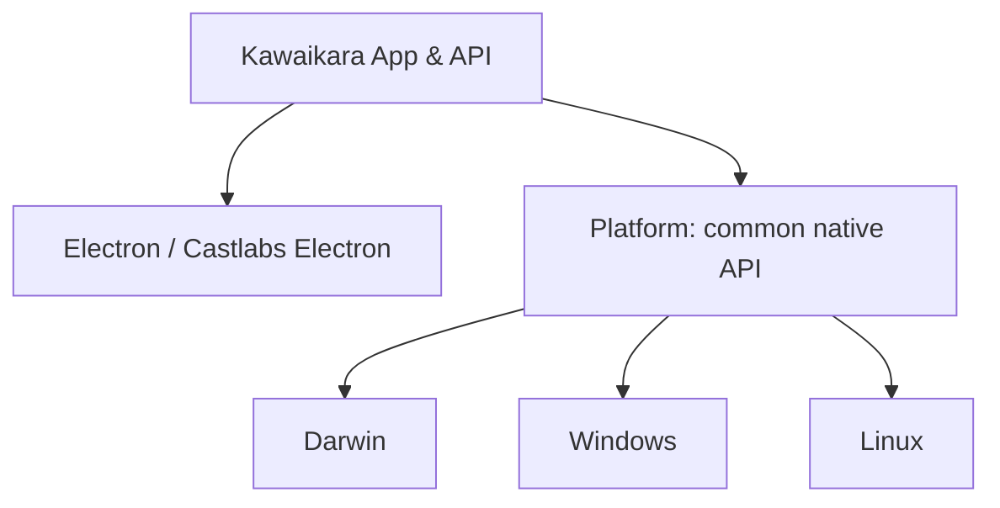
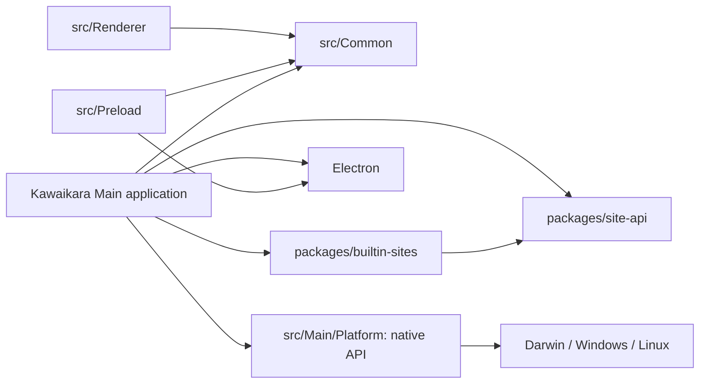
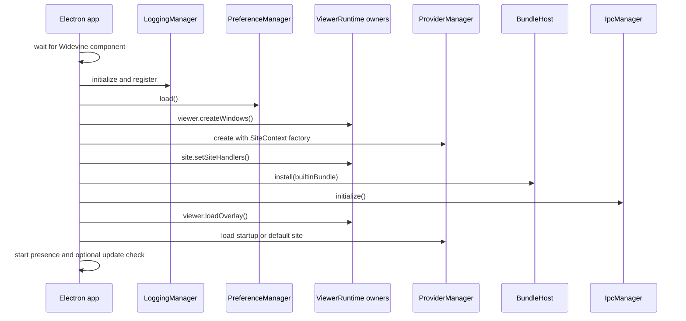
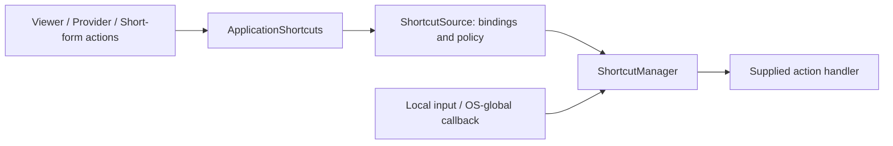

# Architecture Overview

## Main Goals

The `dev` branch, which currently targets version 3.0, separates ownership of the Kawaikara application from ownership of individual site integrations.

- `src` is the application: Electron startup, windows, IPC, preferences, updates, download integration, and UI.
- `packages/site-api` is the stable contract consumed by site plugins.
- `packages/builtin-sites` is the official Bundle shipped with the app.
- Site-specific selectors, login workarounds, user-agent changes, and injected scripts belong to their Provider rather than to a central manager.
- A Provider receives narrow capabilities through `SiteContext` instead of direct access to Electron window objects.

## Repository layout

```text
repository/
├── src/
│   ├── Common/                 # Shared IPC, preferences, build, shortcut, and PiP types
│   ├── Main/
│   │   ├── Main.ts             # Composition root and application lifecycle
│   │   ├── DependencyInjection/ # Manager tokens, construction, and ownership
│   │   ├── Functional/         # Application behavior and reusable Main-process helpers
│   │   ├── Math/               # Pure scalar helpers shared by Main-process features
│   │   ├── Platform/           # Intent-based OS integration and native implementations
│   │   ├── Manager/            # Window, site, IPC, logging, preference, update, and service managers
│   │   ├── Inject/             # Application-owned page injection builders
│   │   └── API/                # BundleHost: site-api Bundle lifecycle integration
│   ├── Preload/                # Restricted bridges for app-owned and remote renderers
│   └── Renderer/
│       ├── Component/          # Reusable application UI
│       └── View/               # Menu, Preference, and Video views
├── packages/
│   ├── site-api/               # Electron-independent plugin contract
│   └── builtin-sites/          # One directory and manifest per Provider
├── stories/                    # Component and view stories with Electron API mocks
└── docs/Developer/             # Developer documentation
```

Directories and files under `Renderer`, `View`, and `Component` use PascalCase to match the project convention.
`src/Main/Main.ts` is intentionally the only file at the `src/Main` root;
implementation files belong to one of its responsibility-based subdirectories.

## Main functional helpers

`src/Main/Functional` groups helpers by responsibility. Keep new helpers in the
matching directory and import the specific module directly. Bundles contain Plugins
and Providers, so their helpers live under `Bundle/Plugin` and `Bundle/Provider`.
Public API names such as `SiteContext` and `SitePagePipeline` retain their existing names.

| Directory | Responsibility |
| --- | --- |
| `App` | Startup, preferences, application data, shortcuts, and IPC validation |
| `Bundle` | Bundle loading, validation, development, and module cache |
| `External` | Browser orchestration, developer links, and external requests |
| `Localization` | Application locale catalogs and renderer message contracts |
| `Logging` | Log records and archives |
| `Bundle/Plugin` | Plugin runtime, capabilities, scope, and descriptors |
| `Bundle/Provider` | Provider registration, settings, locale, page pipeline, and site context |
| `Update` | Update state, local feeds, and reversible installation lifecycle |
| `Video` | Video library, mpv hosting, and video effects |
| `Viewer` | Explicit composition of native-window and feature owners |
| `Window` | Native event connections, detachable surfaces, and WebContentsView transfer |
| `Window/PictureInPicture` | PiP policies, placement, visibility, overlays, and subtitles |

## Shared mathematics

`src/Main/Math/Scalar.ts` contains reusable, Electron-independent `clamp` and
`lerp` operations. Main managers and functional modules import these helpers
rather than repeating bound/interpolation formulas. `clamp` requires ordered
bounds, retains fractions and propagates NaN; callers validate input and choose
when to round. `lerp` intentionally allows extrapolation.

Keep policy with its feature: PiP work-area anchoring, integer window geometry,
validated video aspect-ratio limits, volume defaults and update-progress bounds
remain in their existing domains. Main/Math must not import managers, Platform,
Electron or feature modules. Common/Renderer code must not import Main helpers.
Serialized page injections remain self-contained; importing a Main helper into a
function that is serialized with `toString()` would leave an unresolved reference
in the remote page world.

## Platform boundary

Kawaikara uses Electron and Platform as parallel dependencies. Application code
can use Electron directly wherever the runtime and security boundary permit it.
`src/Main/Platform` provides a common API for native OS integration; managers and
functional helpers use that API instead of selecting OS implementations themselves.
`process.platform` may still be forwarded as diagnostics or Bundle host metadata.



See [Platform and native integration](./7.Platform.md) for implementation maps,
call-flow diagrams, responsibility rules, and current platform limits.

| Module | Common contract |
| --- | --- |
| `Graphics` | Capture-compatible GPU settings and shipped native-video capabilities |
| `Presentation` | Viewer activation, always-on-top repair, PiP presentation and restoration |
| `ExternalFullscreenMonitor` | Fullscreen ownership monitoring with an explicit unsupported implementation |
| `Storage` | Data locator capabilities, path comparison, and filesystem roots |
| `Keyboard` | Primary shortcut modifier and standard redo policy |
| `Updates` | Installer configuration, native staging, and silent-install policy |
| `DefaultBrowser`, `DefaultVideoApp`, `ExternalApplication` | Default browser, default video settings, generic external-app discovery/launch |
| `Information` | Human-readable operating-system identity |
| `Darwin`, `Windows`, `Linux` | Private native implementations of the common feature APIs |

The dependency direction is `Kawaikara App & API → Platform/*.ts → OS implementation`.
`Darwin`, `Windows`, and `Linux` are the only directories under `Platform`. The root
contains feature APIs, shared contracts, and reusable support code. `Runtime.ts`
selects the implementation once per feature. Only these three operating systems
are supported; an unknown OS is rejected instead of silently using Linux behavior.
Native addons load lazily when their selected feature is used.

Callers import a root feature API such as `Platform/Presentation`; they must not
import an OS implementation. OS implementations must not import a sibling OS.
Companion discovery and artifact selection resolve the running OS internally, so
callers do not pass an OS name back into the API. Diagnostic OS metadata remains
available where the app needs to display or record it.

Platform owns native OS integration. Electron window creation, IPC, dialogs,
sessions, and Castlabs Widevine readiness are available directly to their existing
application owners. `ApplicationInitialization.ts` calls `components.whenReady`
itself. Platform implementations may also use Electron to implement a native
policy, such as Darwin fullscreen Spaces or Windows topmost repair; using an
Electron API does not by itself make a function belong to Platform.

Keep application state, preferences, IPC, and user decisions in managers. Platform
code must not import managers or functional application orchestration. A common
contract does not imply identical OS support: unsupported data relocation and
automatic companion installation remain unavailable. Linux currently uses the
existing fallback behavior; native video and desktop integration need separate work.

## External apps (proposed)

The next external-app layer supports `NativeApp` and `WebExtension` through one
protocol with separate discovery and transport adapters. The proposed placement is
`Main/API/ExternalApps.ts` for the facade, `Manager/ExternalAppManager.ts` for
lifecycle, and `Functional/ExternalApps/` for catalog/session logic. Native discovery
and launch stay behind Platform. See [the design](./8.ExternalApps.md) for installer
and portable discovery, Kawaikara self-exposure, browser bridging, and migration.
These capabilities are not yet implemented.

## Descriptor naming

Declarative Provider and Bundle metadata uses `Descriptor`, for example
`ProviderFileDropDescriptor`, `ProviderSettingsDescriptor`, and
`ShortFormVideoDescriptor`. Internal variables and validators follow the same naming.
The manifest stores these declarations under `descriptors`. The site-api package
exports only `Descriptor` types. Bundle authors must update their manifest keys
and type imports together when moving to this API revision; legacy declaration
keys and type aliases are no longer supported.

## Dependency direction



The important rules are:

1. `site-api` does not expose `BrowserWindow`, `WebContents`, `Session`, or other Electron types.
2. `builtin-sites` uses only `site-api` capabilities.
3. Renderer code does not import Main-process managers.
4. Main/Preload/Renderer contracts live in `src/Common`.
5. Remote site pages never receive the full application renderer API.

## Composition root

[`src/Main/Main.ts`](../../../src/Main/Main.ts) is the only place that assembles the runtime.



The app also creates logging, shortcut, external-downloader, update and social services. Shutdown first closes the viewer request gate, then releases shortcuts, external connections, development and Provider runtimes, social services and viewer resources. IPC handlers are removed after renderer teardown. Cleanup attempts remaining owners even when one fails; logging is finalized by application lifecycle.

## Main responsibilities

### Window and viewer owners

- `WindowManager` owns native viewer geometry, monitor placement, fullscreen,
  topmost policy and its native host. It has no Provider, overlay, input, or video state.
- `ViewerController` owns active content presentation, overlay routes, focus choice,
  appearance and the localized transition/failure backing surface.
- `ProviderSiteHost` owns sandboxed site views, sessions, permission-scoped contexts,
  the existing page pipeline, request/identity policies, popups and external login.
- `VideoController` owns retained Video renderer lifetime and open requests;
  `VideoPlaybackRuntime` owns mpv and initialization recovery.
- `ViewerPictureInPicture` coordinates the existing Provider PiP implementation and
  retained Video transfers. It preserves Provider/Plugin eligibility and placement.
- `ViewerInput` resolves input ownership and dispatches semantic actions;
  `ViewerDiagnostics` owns log-viewer and DevTools state.
- `ViewerLifecycle` owns shutdown/update preparation. Application shutdown closes
  the request gate before asynchronous cleanup; failures do not skip later owners.

Viewer components live under `Functional/Viewer`, VideoController under
`Functional/Video`, and ProviderSiteHost under `Functional/Bundle/Provider`.
`Manager` retains WindowManager and the existing application services.

`Functional/Viewer/ViewerRuntime` composes explicit capabilities between these
owners. Callers use named owners (`viewerRuntime.video`, `viewerRuntime.site`, etc.),
not a forwarding WindowManager facade. Feature consumers accept only the subset of
owners they use. `WindowSurfaceHost` and existing detachable/PiP helpers provide
physical attachment and transfer without owning the content's lifetime.

See [Window ownership](./10.WindowOwnership.md) for dependencies, scopes, migration
mapping, and the preserved behavior of site transitions and playback.

### ShortcutManager

`ShortcutManager` owns accelerator matching, local dispatch and its OS-global
registrations. It accepts a `ShortcutSource` that supplies current bindings,
overrides and optional pre-match input routing. It imports no Provider, preferences,
Viewer or media feature implementation and does not interpret action IDs.

Each `ShortcutBinding` declares its handler, default key, repeat eligibility,
editing eligibility and current global eligibility. Registration refresh preserves
unchanged bindings and leaves externally owned accelerators alone. A global callback
reads the current definition before dispatch, so removed/ineligible actions cannot
use an old captured handler. Disposal releases owned registrations and suspends
dispatch; an explicit refresh resumes it for failed-update recovery.

Feature composition lives in `Functional/Shortcut/ApplicationShortcuts.ts`:

- `Functional/Viewer/ViewerShortcuts.ts` owns viewer actions, AOT persistence and
  PiP debounce/coalescing.
- `Functional/Bundle/Provider/ProviderShortcuts.ts` maps Provider selection and
  declared Provider action shortcuts.
- `Functional/Bundle/Provider/ShortFormShortcuts.ts` implements capability-driven
  short-form navigation, auto-advance and publisher filters. These are ordinary
  feature bindings, including for third-party Providers, not dispatcher special cases.
- `Functional/Video/VideoShortcutInput.ts` preserves internal Video renderer input
  ownership, including optional precision modifiers.



PiP state changes and preference saves request a generic registration refresh; no
PiP setter or feature-specific action methods are exposed by the manager. Shortcut
IDs and saved overrides remain unchanged.

### ProviderManager

- Owns committed Bundle/Provider/Plugin registries and commits only fully validated registration plans.
- Maintains exactly one authoritative Provider and its matching Plugin instances.
  Outgoing instances are captured and retired asynchronously while the new
  Provider starts loading; delayed cleanup cannot clear successor state.
  Page hooks and UA/header policy authority are revoked synchronously first.
  Retired context capabilities reject navigation, internal-view changes, login,
  cookie changes, reinjection, and identity changes; repeated old login close is
  inert. Shared cookies/cache are preserved, not reset to accelerate switching.
- Resolves the site locale and Electron Session profile.
- Forwards policy hooks to the active Provider.
- Reloads the current site when its browser-profile assignment changes.
- Reports loading/ready/failed states around the complete serialized transition,
  including context creation and activation. Outgoing async teardown is not a
  prerequisite for activation. A failed menu-driven switch
  reopens the existing menu so retry remains accessible. Transition status lives
  in the app, not in individual Providers or their authenticated documents.

Implementation logic is split by responsibility under `Functional/Bundle`:

| Module | Responsibility |
| --- | --- |
| `Provider/ProviderRegistration.ts` | Prepare a complete registration plan; validate permissions, identifiers, descriptor composition and references before any registry writes |
| `Plugin/PluginRegistration.ts` | Validate Plugin manifest/decorator agreement and Provider scope |
| `Provider/ProviderCatalog.ts` | Build Bundle settings, menu panels and WebExtension catalogs from read-only data and one settings/Plugin-state snapshot |
| `Provider/ProviderBrowserProfiles.ts` | Validate Bundle profiles, resolve user/default/isolated assignments and enumerate storage partitions |
| `Provider/ProviderAddress.ts` | Parse supported URLs and match the most specific declared Provider host |
| `Provider/ProviderLocale.ts` | Resolve localized descriptors and effective app/Bundle/Provider locales |
| `Provider/ProviderPagePolicy.ts` | Install browser identity and page PiP policy; return operations owned and disposed by the activation |

`listBundles()` delegates to `listBundleRuntimeInfo()` rather than serializing
settings and Plugin state inside the manager. Catalog functions never instantiate
Providers or receive the manager itself. The manager retains commit/notification,
transition queue, active ownership, rollback and cleanup ordering. File discovery,
manifest-file reads and Bundle module loading remain with the existing Bundle
loader; this split does not move file I/O into the Provider catalog.

`pnpm test integration pip-visibility-and-site-transition.test.cjs` checks lifecycle ordering and stale-view guards.
`pnpm test electron pip-visibility-and-site-transition.electron.cjs` uses a loopback page with a deliberately stalled
image to verify native presentation before full load, failure-only feedback,
and bounded outgoing cleanup, without loading real sites or installed
application profiles.
`pnpm test electron site-handoff.electron.cjs` drives both real managers and native views with
generated decoded video and deliberately blocked outgoing Plugin, Provider,
renderer-JS, and external-browser cleanup. It asserts the next page is visible
while its own full load is pending, the old native media document is destroyed,
late outgoing capabilities are inert, and shared Session cookies survive.
Use `--minified` to exercise the bundled/serialized runtime path too.

Shutdown, Bundle removal/development reload, and browser-storage resets drain
tracked retired cleanup instead of racing it. Background here means overlapping
async work, not a worker thread: a third-party Plugin performing long synchronous
CPU work in Main can still block Electron and must fix that work independently.

### BundleHost

Lives in `src/Main/API/BundleHost.ts`. This stateful host connects the public
`@kawaikara/site-api` Bundle contract to the app runtime. `BundleManager` owns
discovery and storage, `BundleHost` owns registration transactions and rollback,
and `ProviderManager` owns Provider activation. Reusable loading and validation
helpers remain under `Functional/Bundle`.

- Checks `KAWAIKARA_SITE_API_VERSION`.
- Prevents duplicate Bundle installation.
- Installs Bundles through `ProviderManager`.

User-installed Bundle discovery and compiled JavaScript loading are handled by `BundleManager`.

### Renderer

- Renders the menu, full-overlay preferences, internal Video view, and external-login status.
- Uses KawaiUI for application-owned controls.
- Accesses Main functionality only through a preload API.
- Is developed independently through Storybook mocks where practical.

## Typed IPC

[`src/Common/IPC.ts`](../../../src/Common/IPC.ts) defines the complete namespace-shaped channel tree with `defineIpcChannels()`.

```ts
export const IPC_CHANNELS = defineIpcChannels({
  sites: {
    list: 'kawaikara:sites:list',
    open: 'kawaikara:sites:open',
  },
  // ...
} as const);

export type IpcChannel = LeafValues<typeof IPC_CHANNELS>;
export type IpcChannels = typeof IPC_CHANNELS;
```

This gives Main and Preload autocomplete for both channel paths and channel literal values. Renderer autocomplete comes from `KawaikaraRendererApi` and `KawaikaraVideoApi`, which type the objects exposed through `contextBridge`.

## Registration decision

Decorators attach metadata to Provider and Plugin classes, but they do not register them globally. Registration is explicit through `defineProvider()`, `definePlugin()`, and `defineBundle()`.

This avoids import-order behavior, shared reflection registries between tests, partial discovery, and ambiguous plugin ownership. It also gives a future external loader one export to validate before installation.

## Current boundary versus future work

The application/package split, explicit Bundle definitions, Provider-scoped Plugin activation, profile isolation, typed IPC, runtime capability enforcement, built-in Bundle, validated third-party `.kawai` installation, and HTTPS archive updates/removal are implemented. `.kawai` is a ZIP container with an application-specific extension. External Bundle code loads and unloads on restart under an explicit trusted-code model. Sandboxing, signature checks, and automatic rollback remain planned work.

## Change rules

- Add the smallest possible capability to `site-api` before exposing a new application function to Providers.
- Do not add site-ID conditionals to `WindowManager` for behavior that belongs to one integration.
- Every listener or external resource started by `load()` must be disposed by `unload()`.
- A breaking contract change requires a `KAWAIKARA_SITE_API_VERSION` increment and migration notes.
- Keep IPC channel names, preload methods, Main handlers, and renderer types in sync.


## Test suites and temporary files

Tests are classified by the boundary they exercise, not by the Node test runner.
Mixed files split pure logic and mocked component tests from persisted state,
HTTP, native compilation, and packaging checks. Assertions within an integration
scenario remain with that scenario.

| Directory | Scope | Command |
| --- | --- | --- |
| `tests/Unit` | Isolated logic and components with mocked external dependencies | `pnpm test unit` |
| `tests/Integration` | Module lifecycles, persisted state, local HTTP, and API contracts | `pnpm test integration` |
| `tests/Electron` | Isolated Chromium UI, IPC, native windows, and GPU behavior | `pnpm test electron` |
| `tests/Performance` | Large-log diagnostics and performance measurements | `pnpm test performance` |
| `tests/Packaging` | Release configuration, installer generation, NSIS compile checks | `pnpm test packaging` |
| `tests/Native` | C++ detector fixtures using the Windows build tools | `pnpm test native` |
| `tests/Smoke` | Explicitly selected live-site / compiled-app probes | `pnpm test smoke` |

`pnpm test` (default: `node`) builds the workspace packages and runs Unit,
Integration, Packaging, and Native. It does not run Electron, performance, live-site
probes, or the opt-in installer package smoke. Native fixtures require the Windows
C++ build tools; NSIS compile checks skip when the compiler is unavailable.
Electron suite failures are reported as failures; grouping a suite does not imply
that all tests have passed on every host. Performance timings are diagnostics,
not portable speed thresholds. Live-site probes require network access and may
require `CHZZK_VIDEO_URL`; the compiled-app probe also requires a current app build.

Use `node tests/run.cjs electron --list` to inspect a suite without launching it.
A filename selects a subset, for example
`node tests/run.cjs electron log-viewer.electron.cjs`.
The graphics-mode probe runs all three modes when selected.
Root package scripts expose only one test entry point: `pnpm test`. The first
argument selects the suite, followed by optional filenames. `pnpm test --help`
prints usage; `--list` never builds packages or launches tests. Suites that need
compiled workspace packages build them automatically; Unit, Packaging, and
Native run directly. All scratch files remain under `tests/tmp`.

`tests/Helpers/Paths.cjs` provides the project-local `tests/tmp` scratch root.
The runner also sets child-process TEMP, TMP, and TMPDIR there. Each fixture uses
a unique directory. NSIS scripts, compiled fixture EXEs, generated artwork,
optional preview output, and native test binaries stay below this ignored root.
Tests may retain artifacts for diagnosis; none of these fixture installers are
executed automatically. `KAWAI_INSTALLER_PREVIEW=1 pnpm test packaging windows-installer.test.cjs` compiles
an inert preview; `KAWAI_INSTALLER_PACKAGE_SMOKE=1 pnpm test packaging windows-installer.test.cjs` explicitly
enables dummy-app packaging. Both remain under `tests/tmp`.
The NSIS compiler is read from NSIS_HOME or the existing electron-builder cache;
it is not copied into the project. Persistent manual update-test builds/profiles
remain under the existing `tests/Release` path.

Provider-owned browser features and the implemented authenticated loopback adapter are described in [Provider WebExtension](9.ProviderWebExtension.md). Provider registration publishes browser declarations without activating its app viewer.

## Window ownership implementation

[Window ownership and application coordination](./10.WindowOwnership.md) records
the implemented boundary, owner mapping, event flows and validation strategy.

### Logging and shared file operations

`LoggingManager` owns the session identity, source preferences, pending native-picker
tokens and one parsed-document cache. It coordinates these functional modules:

| Module | Responsibility |
| --- | --- |
| `Logging/LogSession.ts` | Persistent installation identity and trusted session metadata/file names |
| `Logging/LogTransport.ts` | electron-log initialization, severity/source policy and scoped loggers |
| `Logging/RendererLoggingEvents.ts` | Renderer diagnostics registration and complete listener teardown |
| `Logging/LogRepository.ts` | Validated repository/group lookup, document caching and deletion |
| `Logging/LogTransfer.ts` | Native pickers and bounded import/export workflows |
| `Logging/LogParsing.ts` | Metadata validation, entry retention and imported text sanitization |
| `Logging/LogConstants.ts` | Log-specific limits and format markers |
| `Files/FileRead.ts` | Regular-file reads with explicit byte and symlink policy |
| `Files/JsonFile.ts` | JSON decoding into `unknown`, with filesystem/syntax failures preserved |

Functional modules never receive a manager instance. Repository functions accept a
small `LogRepositoryState`, so file work can be tested with isolated directories.
Renderer logging accepts a scoped-logger factory and returns a disposer; explicit
disposal removes the `destroyed` callback too. The manager consumes import tokens
before file operations, preserving their one-use and expiry semantics.

The shared file layer deliberately does not know Bundle, Provider or log schemas.
Bundle manifest loading translates missing/invalid JSON into Bundle errors; log
imports impose byte limits, reject links and validate their own metadata. Linked
manifest paths retain their existing support. One-off formatting helpers stay
private inside their feature module. Avoid wrapping every filesystem call or
introducing a general manager solely to share I/O.
