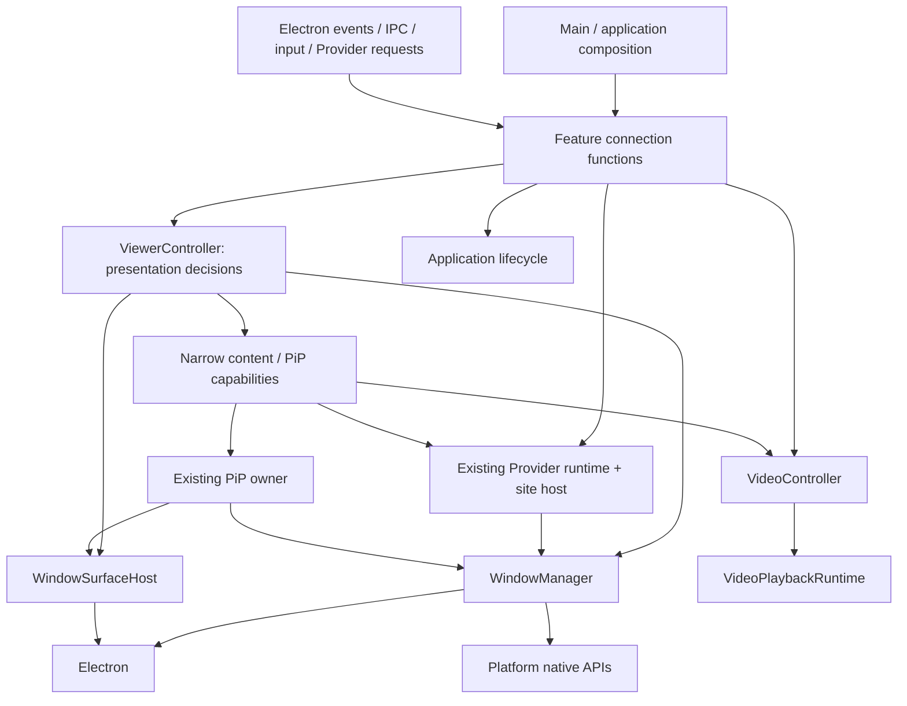
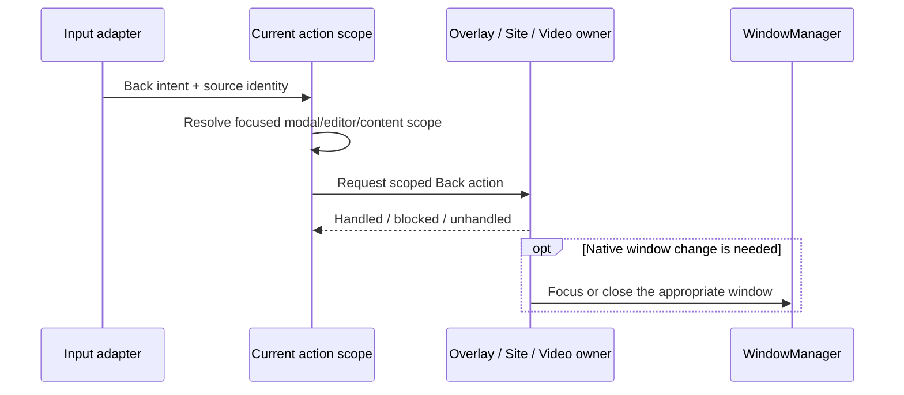

# Window Ownership and Application Coordination

**Status: implemented ownership split (2026-10-20).** The native-window,
presentation, Provider-hosting, Video, PiP, input, diagnostics and lifecycle owners
are composed by `Functional/Viewer/ViewerRuntime.ts`. The sections below record the
design and migration criteria; the concrete implementation mapping follows here.

| Runtime owner | Implementation |
| --- | --- |
| Native viewer window | `Manager/WindowManager.ts` |
| Presentation and overlays | `Functional/Viewer/ViewerController.ts` |
| Existing Provider runtime's site host | `Functional/Bundle/Provider/ProviderSiteHost.ts` |
| Retained Video renderer and requests | `Functional/Video/VideoController.ts` |
| PiP coordination, reusing UnifiedPictureInPictureManager | `Functional/Viewer/ViewerPictureInPicture.ts` |
| Input / diagnostics / lifecycle | `Functional/Viewer/ViewerInput.ts`, `ViewerDiagnostics.ts`, `ViewerLifecycle.ts` |
| Physical surface attachment | `Functional/Window/WindowSurfaceHost.ts` and existing transfer helpers |

Implementation choices: preserve ProviderManager's existing serialized activation
queue and current-WebContents identity checks rather than introducing a second
activation scheduler. Native viewer ownership is centralized; existing scoped PiP,
popup and detachable-surface helpers retain auxiliary native hosts. Playback recovery
returns to VideoController. Connection functions return disposers, and IPC consumers
use explicit owner subsets. No production compatibility facade remains.

[한국어](../i18n/ko/Architecture/10.WindowOwnership.md)

## 1. Decision and scope

`WindowManager` manages native windows, not the application presented inside
them. Extracting event listeners is insufficient if their callbacks still ask the
manager to choose Providers, interpret Back, authorize navigation, or control video.

Separate three concerns:

1. **Mechanism:** create, position, resize, show, focus, and destroy native windows.
2. **Application decisions:** choose active content, overlays, navigation actions,
   media presentation, and transitions between them.
3. **Connections:** bind Electron, IPC, input, and Provider signals to their owners.

Do not introduce a universal EventManager, PipelineManager, global event bus, or
service locator. Connection modules are functions with explicit dependencies and
scoped disposal. Stateful controllers exist only where they own a real lifecycle.
The composition root assembles these owners; it does not implement their behavior.

This refactor preserves public Renderer/Preload IPC and `site-api` contracts,
Provider/Plugin settings and permissions, retained playback, PiP behavior, startup
placement, and update recovery. It does not redesign these features or introduce
new native implementations.

## 2. Owners and state

| Owner | Owns | Does not own |
| --- | --- | --- |
| `WindowManager` | Native window registry and lifetime; geometry, display placement, visibility, native fullscreen, requested/effective topmost state and focus operations | Active Provider, overlay routes, editor focus, navigation history, video requests, mpv, permissions or application shutdown sequencing |
| `WindowSurfaceHost` | Physical attachment, ordering, bounds and focus of supplied `WebContentsView` surfaces; ownership checks during transfer | Creating a video/site renderer, deciding which feature becomes active, loading URLs or interpreting content |
| `ViewerController` | Active content identity, overlay route, foreground focus target and serialized presentation transitions | Provider sessions, request interception, media decoding, settings persistence, arbitrary IPC routing |
| Provider runtime / site host | Existing Provider/Plugin lifecycle plus site sessions, scoped `SiteContext`, navigation policy, browser identity, site page pipeline and external-login workflow | Native window registry, app overlay routes, mpv |
| `VideoController` | Retained video renderer lifetime, pending/current open request, media presentation metadata, renderer commands and replacement | Native window geometry, Provider authorization, decoder internals |
| `VideoPlaybackRuntime` | mpv service, renderer attachments, capability reporting, readiness/watchdog and fallback | App routing, choosing when to open Video, native host selection |
| Existing PiP owner | PiP session, eligibility, transfer/restore transaction, placement policy, subtitle and Plugin integration | Provider selection, other app overlays, a second mpv implementation |
| Input routing / `ShortcutManager` | Raw input normalization, editor/modal ownership and configured shortcut resolution | Windows, Provider lifecycle, playback service lifetime |
| Application lifecycle | Startup, shutdown/update preparation, coordinated cleanup and failed-update recovery | Feature internals or raw keyboard rules |

`WindowSurfaceHost` is a focused window helper, not another application manager.
Prefer extending `DetachableWindowSurface` and `WebContentsViewTransfer` where
appropriate. Its caller retains renderer lifetime ownership: detaching a surface
must not silently destroy the renderer or its playback session.

Keep `ProviderManager`, `SitePagePipeline`, and the existing PiP implementation.
Extract cohesive state currently in WindowManager into those owners or a site-host
helper; do not create a parallel Provider runtime. `ViewerController` accepts narrow
content operations such as present, suspend, and release. It must not accumulate
all feature services as constructor dependencies.

For topmost behavior, WindowManager may observe native fullscreen and apply
Platform policy. Application-specific suppression (for example, an active PiP
session) arrives as a scoped presentation constraint, not a query into PiP state.
Native window snapshots are observable facts; they are not a second copy of
ViewerController's active-content state.

## 3. Dependencies and connection lifetime

Arrows express allowed calls, not permission to pass an entire manager. A site
popup receives a scoped window-creation capability, for example; a Provider never
receives the native registry or Electron objects. Completion signals flow back
through callbacks supplied at composition, without reverse imports into controllers.

- WindowManager must not import ProviderManager, ViewerController, VideoController,
  IPC feature modules, `ShortcutManager`, or `electron-mpv-video`.
- Only playback modules import the native player service. Native OS functionality
  remains behind the existing Platform feature APIs. Electron remains an independent
  dependency; this refactor does not place Electron behind Platform.
- Connections read current state through narrow getters at dispatch time, rather
  than capturing an old Provider, renderer, or preference snapshot.
- Each connection returns an idempotent disposer. Its lifetime is explicitly app,
  window, renderer, or Provider activation. Failed setup releases earlier bindings.
- Renderer replacement disposes its connection scope before binding the replacement.
  Global screen/input subscriptions are always explicitly released. Destruction of
  a window alone does not clean up listeners on other objects.

Placement follows feature responsibility, even when an object owns application-lifetime
state. Viewer presentation, input, PiP coordination, diagnostics and lifecycle live
under `Functional/Viewer`; VideoController lives under `Functional/Video`;
ProviderSiteHost lives under `Functional/Bundle/Provider`. They are implementation
components composed by `Functional/Viewer/ViewerRuntime.ts`, not additional global
managers. WindowManager remains under `Manager`. Native window mechanisms stay in
`Functional/Window`, IPC adapters in `Functional/IPC`, and application startup in
the existing initialization/DI modules. Do not add implementation files directly
under `Main`, or create a generic `Pipelines` directory.

## 4. Event and command flows

### Back and input

Native editing has priority. The top modal scope may block an action even when it
cannot navigate back; a blocked action must not fall through to an underlying page.
Overlay Back, site history Back, video-directory Back, and native browser-button
navigation are distinct commands after routing. Preserve current rules: physical
browser commands navigate Video directories only when that surface is eligible;
this refactor must not enable new Back behavior elsewhere.

WindowManager never decides what Escape, Tab, Space, or Back means. Renderer-owned
popup/unsaved-change rules remain renderer-owned. A close request awaits the existing
renderer decision where applicable; it is not an unconditional hide operation.

### Provider activation and site pipeline

ProviderManager retains activation authority. Its site-host capability creates or
selects the session and surface, constructs the permission-scoped context, and
installs the existing `SitePagePipeline`. ViewerController coordinates visible
content handoff through that capability, rather than manipulating the pipeline.

Each activation has an identity/revision. After every asynchronous prepare/load/
injection step, the owner checks that identity and its disposal state before
publishing results. Replaced contexts lose capabilities immediately. Late navigation,
request transforms and popup creation from a retired Provider cannot affect the new
surface. PiP eligibility continues to use committed main-frame navigation rather
than transient SPA URLs. Provider action schemes in subframes retain their existing
narrow interception policy.

### Video and PiP

An accepted video-open request goes to VideoController. It owns request identity,
retained renderer reuse, and renderer commands; ViewerController is asked to present
Video and select its focus target. WindowManager is involved only if a native window
must be shown, moved, or focused. Download jobs stay with their existing owner.

PiP asks the active content capability and configured Provider/Plugin policies
whether transfer is allowed. The PiP owner coordinates host creation and surface
transfer, then commits the presentation change. A failed transfer restores the last
valid host and focus. Moving a retained Video surface does not recreate mpv.

Playback recovery requests a replacement from VideoController. It checks that the
request still refers to the owned renderer and that shutdown/PiP does not prohibit
replacement. PlaybackRuntime owns backend selection; the controller owns renderer
replacement and asks the presentation layer to reattach it. There is no callback
from PlaybackRuntime into WindowManager.

## 5. Transactions, preferences, and teardown

Use per-owner transitions, not one global queue. ViewerController serializes visible
presentation changes; the Provider runtime serializes activation; VideoController
coalesces renderer creation/recovery. Establish one caller direction so a transition
never awaits another owner which synchronously waits for the first queue.

New activation supersedes older work by revision. Cancellation means both stopping
cancellable work and refusing stale completion; a non-cancellable Electron operation
may finish but cannot commit state. PiP enter/exit must not overlap a surface transfer
or renderer replacement. Explicit states distinguish preparing, presented,
restoring, and disposed instead of unrelated booleans spread across owners.

PreferenceManager persists configuration and passes only relevant values to each
owner: startup bounds to WindowManager, shortcuts to ShortcutManager, PiP policy to
the PiP owner, and theme/locale/Provider settings to their existing feature owners.
Do not duplicate preference storage or reset Plugin settings during migration.

Application shutdown or update preparation follows an explicit transaction:

1. Intercept the native close synchronously and let application lifecycle decide
   whether to proceed; WindowManager does not call media cleanup itself.
2. Stop accepting new feature requests and retire activation scopes. Gate callbacks
   while preserving any internal restore operations needed for cleanup.
3. Capture normal bounds and PiP placement before removing native hosts.
4. Restore/end PiP and finish content-owned cleanup. Release mpv attachments before
   destroying Video WebContents; close site-owned popups and external-login sessions.
5. Dispose connection scopes and native windows, then app-level services. Cleanup
   attempts remaining owners even if an earlier owner fails and reports errors.

Repeated close requests share one preparation operation. Update preparation retains
an explicit recovery path: if installation fails, restore presentation and request
acceptance without duplicating connections. Final shutdown and reversible update
preparation must not be collapsed into the same irreversible disposer.

## 6. Current-to-target migration map

| Current WindowManager responsibility | Target |
| --- | --- |
| `createWindows`, startup placement, bounds/fullscreen/native topmost | WindowManager; overlay/content creation moves out |
| `connectWindowInput`, `dispatchWindowInput`, `setEditingState` | Input connection + action scopes; editor state belongs to its renderer scope |
| Overlay visibility/routes and active-content focus selection | ViewerController; physical focus operation stays in window/surface helpers |
| `createSiteContext`, `createSiteViewer`, `configureSiteSession`, browser identity | Existing Provider runtime's site-host helper |
| `setSiteHandlers`, `SitePagePipeline`, navigation/request guards | Provider activation scope and site connection |
| `activateSiteView`, transition status and surface handoff | Site owner prepares content; ViewerController commits presentation |
| Video request queue, local file selection, `ensureVideoView`, `replaceVideoPlaybackView` | VideoController; file-dialog/filter helpers remain feature-local |
| `recoverVideoPlaybackRenderer`, readiness and playback capability forwarding | IPC connects directly to the Video owner/runtime |
| Internal-video and Provider PiP orchestration | Existing PiP owner with content-specific capabilities |
| External login, site popups, DevTools and log-viewer feature behavior | Their scoped feature hosts; native creation/geometry use window capabilities |
| Update preparation and viewer-close sequencing | Existing application lifecycle, using explicit participant operations |

Split responsibilities within a method when necessary. Moving a complete method
with all its manager dependencies is not evidence that the boundary is correct.

## 7. Migration stages and verification

1. **Define ownership and scopes.** Inventory current call sites and observable
   behavior. Define narrow window/surface/content capabilities and disposal scopes.
   Keep existing IPC and Provider contracts. Add boundary checks for forbidden imports.
2. **Move input and presentation ownership.** Route semantic actions to the current
   scope and move active-content/overlay decisions to ViewerController. Verify editor,
   modal, unsaved-change, focus and small-window behavior.
3. **Move Provider hosting.** Move site context/session/pipeline and external-login
   ownership out of WindowManager. Rebind ProviderManager's factory in DI. Verify
   permissions, stale activation rejection, browser-profile isolation, popup policy,
   committed navigation and enabled/disabled Plugin behavior.
4. **Move Video and finish PiP integration.** Move request and renderer lifetime to
   VideoController, reconnect PlaybackRuntime, and use existing PiP policy. Verify
   retained playback position, open requests, fallback, failed transfer and disposal.
5. **Move lifecycle composition and remove the facade.** Update IPC, shortcuts,
   preferences, update and startup call sites to target their real owners. A temporary
   forwarding facade may live outside WindowManager during migration; remove it
   when call sites have moved. Verify repeated startup/close and failed-update recovery.

Each stage must remain runnable and independently testable. Use existing Node and
Electron tests plus targeted UI checks for focus, modal dismissal, PiP and window
placement. Build/type checks alone do not prove native presentation correctness.

Completion means WindowManager has no Provider identity, overlay route, video-open
request, editing state, page pipeline, input interpretation, or playback service.
Every mutable state has one owner; each long-lived connection has a disposal scope;
window shutdown does not require WindowManager to know the feature inventory.

## 8. Deliberate constraints

This is an internal ownership change, not a new public extension API. Use typed
callbacks and existing IPC rather than a generic string-command registry. Reuse
existing feature managers and helpers before adding new classes. Native window
handles remain inside trusted Main code. Preserve security validation at each
capability/IPC boundary; a semantic command alone is not authorization.

Choose exact type/file names during each implementation stage, but do not reopen the
ownership decision merely to retain convenient WindowManager access. If a callback
needs the whole application container, its capability boundary is too broad.
