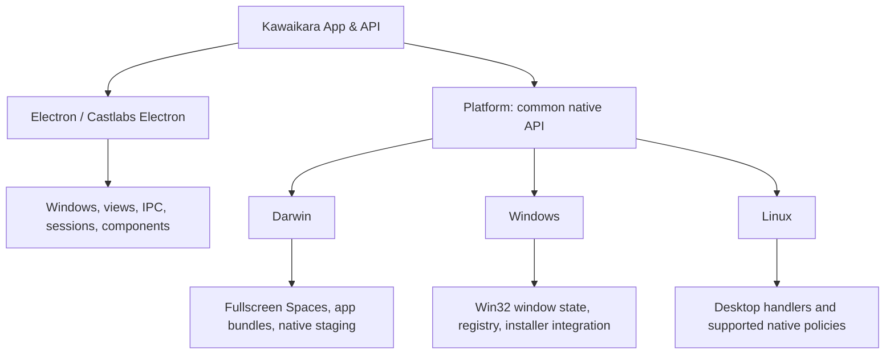
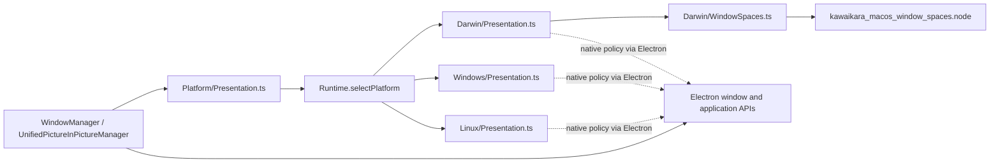
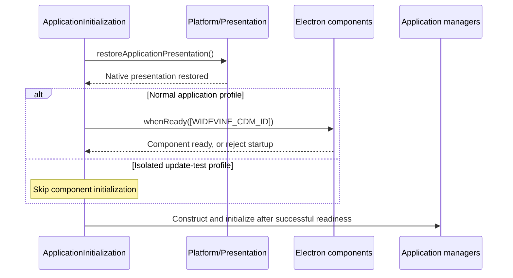

# Platform and Native Integration

## Responsibility

Kawaikara depends on **Electron and Platform in parallel**. Electron APIs are
available directly to application code wherever the process and security model
allow them. Platform exposes native OS capabilities through a common API, so
application callers do not select Darwin, Windows, or Linux implementations.



The arrows describe application dependencies, not the implementation of Electron
itself. Electron's use of native code does not require routing its APIs through
Platform. Existing renderer isolation, preload bridges, and site-api capability
restrictions still apply; this separation grants no additional process privileges.

## Choosing the owner

| Work | Owner and entry point |
| --- | --- |
| Create a `BrowserWindow` or `WebContentsView`, use IPC, dialogs, or sessions | Application code uses Electron directly |
| Wait for Castlabs Widevine components | `Functional/App/ApplicationInitialization.ts` calls `components.whenReady` directly |
| Apply native PiP workspace/activation policy or repair lost native topmost state | `Platform/Presentation.ts` |
| Observe external fullscreen ownership through a native addon | `Platform/ExternalFullscreenMonitor.ts` |
| Read an installer-owned data locator or enumerate native filesystem roots | `Platform/Storage.ts` |
| Configure native signature checks and prepare the OS updater handoff | `Platform/Updates.ts` |
| Discover, install, or launch a companion through native registration | `Platform/ExternalDownloader.ts` |
| Decide when to show PiP, ask for consent, save preferences, or notify the renderer | Application managers and functional helpers |

Platform implementations may use Electron themselves. For example, Darwin
presentation combines Electron activation/workspace APIs with the native
fullscreen Spaces bridge; Windows presentation repairs native topmost state
using Electron window methods. The reason those functions live in Platform is
the native policy they encapsulate. There is no requirement to wrap every Electron
API, and Castlabs component management is not a Platform responsibility.

## Implementation map

Only three directories exist under `src/Main/Platform`:

```text
Main/
├── Functional/App/ApplicationInitialization.ts  # Direct Electron component readiness
├── Manager/                                    # Application orchestration
└── Platform/
    ├── Presentation.ts                         # Common native feature API
    ├── Storage.ts, Updates.ts, Graphics.ts      # Common native feature APIs
    ├── ExternalFullscreenMonitor.ts            # Common monitor factory
    ├── DefaultBrowser.ts, DefaultVideoApp.ts
    ├── ExternalDownloader.ts, Keyboard.ts, Information.ts
    ├── Runtime.ts                              # Selects the running OS implementation
    ├── ...                                     # Shared contracts and support functions
    ├── Darwin/                                 # Private Apple desktop implementations
    ├── Windows/                                # Private Windows implementations
    └── Linux/                                  # Private Linux implementations
```



`Runtime.selectPlatform` chooses one implementation at feature-module evaluation.
It accepts `darwin`, `win32`, and `linux`; other targets fail explicitly. Native
addons are loaded only when their feature needs them. Application code imports
root feature modules, such as `Platform/Presentation`, and never OS directories.
OS implementations do not import sibling OS implementations or application
managers. Shared contracts and reusable helpers stay at the Platform root.

## Call flows

Startup uses both dependencies independently. The update-test profile keeps its
existing component-initialization bypass in application code.



A caller can also use both APIs in the same operation. The following example runs
after Electron is ready; the application retains ownership of the window's lifetime.

```ts
import { BrowserWindow } from 'electron';
import { configurePictureInPictureWindow } from '../Platform/Presentation';

const window = new BrowserWindow({ show: false, frame: false });
configurePictureInPictureWindow(window);
```

The caller creates the Electron object and delegates its native presentation policy.
It does not test `process.platform` or import `Darwin/Presentation`.

## Capabilities and limits

A common API does not imply identical support on every OS. Custom data locations
and native default-video-app settings currently require Windows. Automatic
companion installation supports Darwin application bundles and Windows installers;
Linux can discover and launch a registered desktop handler. Explicit external
fullscreen monitoring is implemented on Windows, with unsupported monitor objects
on Darwin and Linux. Native video availability remains limited to the shipped
Windows x64 and Darwin arm64 targets.

Callers use capability functions such as `supportsCustomDataLocation()` and
`hasNativeVideoBackend()`, or the monitor's `supported` property. Passing OS names
back into native operations is unnecessary. OS names may still be recorded in
logs, host metadata, and status results.

## Verification and extension

- Add a common feature API at the Platform root when new native integration is needed.
- Implement OS differences inside `Darwin`, `Windows`, and `Linux`, with explicit unsupported behavior where necessary.
- Keep application state, consent, and lifecycle coordination in application code.
- Use Electron directly for Electron features, including Castlabs component APIs.
- `tests/Unit/platform-boundary.test.cjs` checks directory and import boundaries.
- `tests/Unit/platform-policy.test.cjs` exercises native behavior through the common API across simulated operating systems.
- `tests/Unit/application-initialization.test.cjs` checks direct Electron readiness, failure propagation, and the update-test bypass.

These tests verify composition and policy. They do not replace real OS testing of
native addons, fullscreen transitions, or installer execution.
