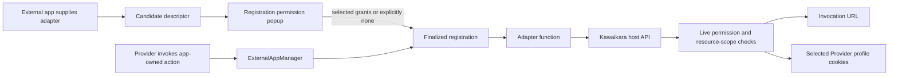
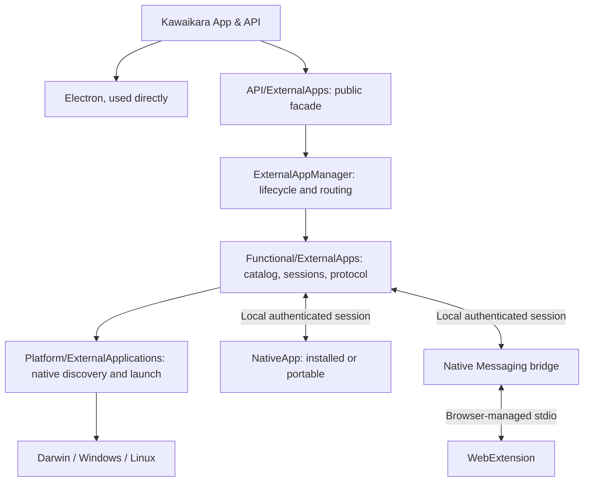
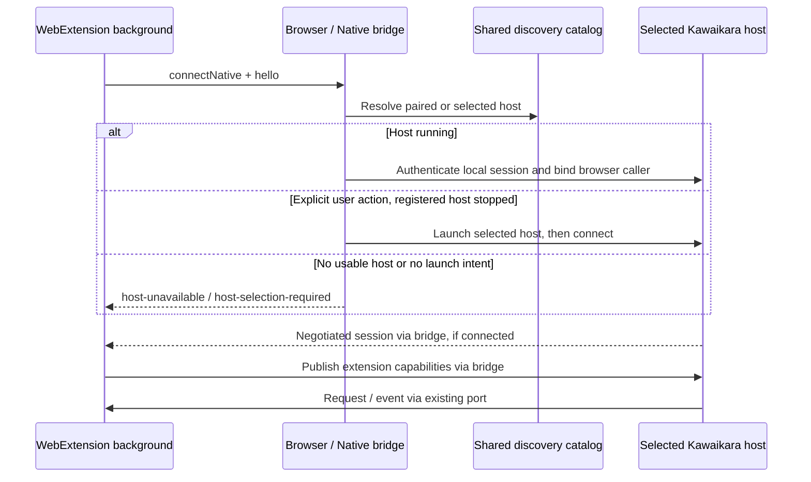
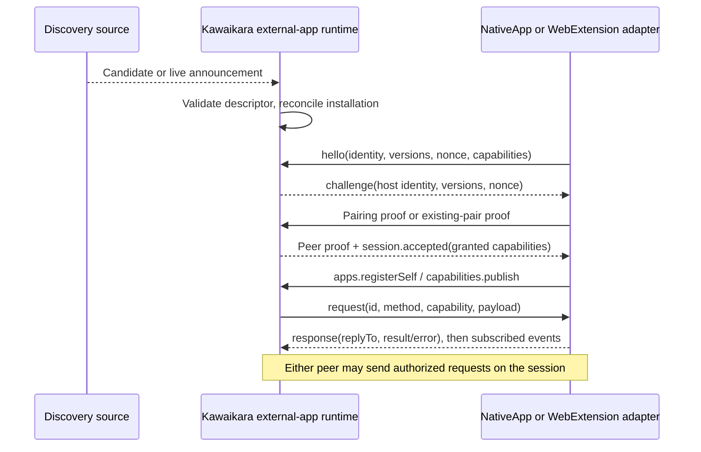

# External Apps: Discovery and Communication

> The Provider-owned WebExtension slice is now implemented with code-free discovery of running apps and authenticated loopback pairing; see [Provider WebExtension](9.ProviderWebExtension.md). General discovery and Native Messaging below remain proposed.

**Status: partially implemented.** The generic registry and Provider-owned download
routing described below are implemented. Broader installation catalogs, portable
registration discovery, Native Messaging and the remaining discovery/protocol
design in sections 1 onward are proposals unless explicitly marked implemented.

## Public distribution manifests (implemented)

Provider-owned setup resolves a public HTTPS `kawaikara.manifest.json` URL
from the Provider declaration. Settings manages connections and permissions; it
no longer offers standalone manifest installation. Viewing a manifest does not register an app,
load an adapter, grant cookies/URL access, or execute its launch scheme. This
public distribution descriptor is separate from `ExternalAppDescriptor`, which
continues to describe authenticated adapter actions and permission requests.

The schema is [external-app-distribution.schema.json](../../../resources/schemas/external-app-distribution.schema.json).
`schemaVersion`, stable `id`, display `name`, and `targets` are required. Each target
specifies `os` (`darwin`, `win32`, `linux`) and `arch` (`arm64`, `x64`, `ia32`, `arm`,
`universal`). Exact architecture matches take precedence over universal matches;
within that group the first entry is preferred. A target may have `version`,
`guideUrl`, and an `artifact` containing HTTPS `url`, `sha256`, and `format`.
An instructions-only target is valid. A missing target means unsupported, rather
than falling back to a package for another operating system.

Common `icon`, `homepage`, and `guideUrl` accept public HTTPS URLs, including
GitHub Raw/Release assets and other hosts. Relative references resolve against the
original manifest URL, not a transient CDN redirect. A target guide overrides the
common guide. Optional `connection` contains advisory `protocolVersion`,
`transport: "loopback"`, `launchScheme`, and `guideUrl`; a target can replace that
whole declaration. Scheme strings are displayed, never run from the document.
Connection and permission approval continue through existing registered adapters.

macOS DMG/PKG and Windows EXE/MSI offer an explicit **Install** action that asks
for confirmation, streams the file, verifies SHA-256, records OS download
provenance, and opens the native installation UI. It does not remove quarantine,
request administrator rights itself, or mark the app as installed/connected.
ZIP and Linux AppImage/DEB/RPM/TAR.GZ currently provide verified **Download** and
installation instructions; they are not silently unpacked or executed.

Main owns all fetching and installer actions. Public DNS addresses are checked
and pinned for each request, including redirects; private networks and embedded
credentials are rejected. Fetches do not use browser cookies. Manifests are
limited to 256 KiB, icons to 512 KiB and 2048×2048 raster dimensions, and artifacts
to 2 GiB. Icons are normalized to PNG before entering Renderer. The source-scoped
cache retains at most 32 records and is independent from authenticated handshake
icons. An offline preview is visibly identified as cached. A 20-minute opaque
preview token binds subsequent actions to the exact source and checksum shown.
A checksum validates bytes, not publisher identity; the source and native OS
security checks remain visible to the user.

The Provider requirement panel resolves the Provider-declared app ID through its
`externalAppManifests` mapping. A failed manifest lookup does not switch that
panel to the legacy fixed installer. The downloader release tools generate
`kawaikara.manifest.json` and `kawai-downloader-icon.png` with version-pinned assets.
No publishing occurs merely by building locally.

For a practical publishing and integration walkthrough, see the
[external app developer guide](../ExternalApps/README.md).

## Implemented app-owned adapters and consent



There is no shared media/download operation in the external-app API. Each app
supplies an `ExternalAppAdapter` with its descriptor, discovery implementation and
function dispatcher. Function IDs, parameters and successful result values belong
to the adapter. `offer()` adds a candidate, not an approved registration. The
current native companion integration is offered by application composition;
untrusted remote JavaScript is never evaluated as an adapter. Future remote
registrations must bind data declarations to an authenticated transport.

`register()` presents all declared permissions as independently selectable,
initially unchecked grants. Cancel leaves the app unregistered. Explicit approval
of an empty subset registers a restricted app; only actions requiring denied grants
are disabled. Calling an unregistered app first runs this registration flow.
The trusted settings popup shows origin scopes, optional cookie access and which
actions would be enabled. Advanced settings lists registrations and supports revoke.

Grants persist in `external-apps.json`, bound to a digest of the complete descriptor.
Changing actions, origin scopes, permission declarations or adapter revision requires
new approval. Concurrent requests are serialized; repeated calls for one unchanged
app reuse consent. Revocation invalidates saved host handles and in-flight cookie
reads. Reapproving the same app does not reactivate old handles.

The host currently implements `resource.url` and `cookies.read`. Permission IDs
are adapter-local. Origins must be exact HTTPS origins, with no wildcard cookie
grants. A Provider invocation captures its validated URL and selected profile.
The adapter cannot choose another URL or browser partition when asking the host
for cookies. Reads use Electron's URL cookie filter and recheck grants and Provider
ownership after the asynchronous operation. Cookie values never enter logs,
settings IPC, saved grants or deep links.

YouTube and CHZZK invoke the companion adapter's `open` action. Its `source`
permission enables URL handoff; its independent `session` permission enables cookie
requests without making cookies mandatory for opening public sources. The existing
companion callback transport exposes authenticated `POST <callbackUrl>/host`
requests with `{ "method": "resource.url", "permission": "source" }` or
`{ "method": "cookies.read", "permission": "session" }`. Unknown/denied operations
return an error without resource data. Cookie consumption in the external app must
use this host endpoint; approval alone does not push cookies into a downloader job.
The companion Main process now requests optional cookies on the first preview or queue
operation for a handoff. Concurrent requests share one decision. Denial/timeout
continues without cookies. Approved records travel only from Main to its private
Worker; they are not written into the user's persistent cookie settings or sent
to Renderer. The Worker binds them to the request ID and original video source,
keeps at most 128 contexts for one hour, and creates mode-0600 disposable jars for
individual preview/download operations. An expired or denied companion context
never falls back to another saved account's cookies. Already delivered cookie
snapshots cannot be recalled by revoking permission in Kawaikara; revocation stops
future host reads.

The manual companion panel uses the same registration boundary. Installation alone
does not grant URL or cookie access. Existing missing-installation setup behavior is
preserved. WebExtension consent remains independent of native-app resource grants.

### Companion identity

The product is **kawai-downloader**. Its stable `appId` is
`day.faby.kawai-downloader`, already declared by the downloader's `build.appId`
and `kawaikara-companion.json`. Provider manifests and the adapter use that ID.
The canonical launch scheme is `kawai-downloader://`. New downloader builds also
accept `yt-downloader://` as an inbound compatibility alias. Older downloader builds
need updating before receiving canonical links. Repository/package names are unchanged.

The former IDs `yt-downloader` and `com.ytdownloader.app` are retired. Saved grants under
those keys are not aliased or copied to the canonical ID: the next invocation asks
for registration again. An old entry can be removed from external-app settings.
The ID identifies the product; it is not proof of the installation's authenticity.

### Provider policies and the open handoff

A Provider declares `descriptors.externalApps: ["day.faby.kawai-downloader"]` in its manifest.
The resource-scoped facade rejects discovery/invocation of undeclared apps. The
Advanced preferences panel, above WebExtension, lists registered apps and only
currently loaded Providers declaring them. Each pair has an enable switch, URL
permission controls and cookie policies (`ask`, `allow`, `deny`). Disabling a pair
does not affect other Providers; removing the app revokes every pair.

Registration approvals are initially unchecked. Selecting cookies authorizes a
future prompt, not automatic cookie delivery. A cookie prompt identifies the app,
Provider and declared origins, offering deny, allow once, or always allow. Closing
it denies the read. Always-allow persists for that Provider and permission only;
Preferences can restore ask/deny at any time. Old app-wide cookie grants are not
migrated into Provider access. Registration and per-use prompts share one bounded
queue, and policy edits revoke existing resource handles and pending prompts.

YouTube/CHZZK menu labels say **Open in downloader**. The handoff opens/focuses the
external editor with a URL; no download job or selected range is created by
Kawaikara. Cookie access is optional and does not depend on guessing whether the
video is private. Opening a public source still works after denial; private or
account-restricted sources may fail inside the downloader. Its accepted-source
receipt is sufficient. Queue progress is disabled by default and available only through an explicit adapter opt-in.

## 1. Two app kinds, one protocol

`NativeApp` and `WebExtension` implement the same Kawaikara external-app protocol:
identity, version negotiation, capability publication, requests, responses, events,
and disconnection. Their discovery and transport adapters differ. A browser bridge
is infrastructure, not a third external-app kind. Kawaikara exposes itself as a
native host using the same discovery rules, including when it is portable.



**Directory decision:** keep the current Main organization. Put the public facade
in `Main/API/ExternalApps.ts`, the lifecycle owner in
`Main/Manager/ExternalAppManager.ts`, and catalog/session/transport logic under
`Main/Functional/ExternalApps/`. Do not introduce another top-level Main directory
for this initial implementation. Registry access, OS-specific discovery paths,
native watching, process identity checks, and executable launch go through root
Platform APIs, with implementations in the three OS directories. Generic HTTP,
JSON validation, routing, and capability state belong to the external-app runtime.

Publish transport-independent JSON schemas and a small client SDK as the proposed
`packages/external-app-api`. This lets a non-Electron native app or an extension
participate without importing `Main` or Electron. External applications define their own adapter actions; the host API standardizes
resource permissions and invocation envelopes, not application features.

## 2. Identity and independent state

| Identity | Lifetime |
| --- | --- |
| `appId` | Stable product identity, independent of display name |
| `installationId` | One installed/portable copy, or one extension profile installation |
| `instanceId` | One running process or extension background connection generation |
| `sessionId` | One authenticated, negotiated connection to a specific Kawaikara host |

Record `kind`, app version, channel, protocol range, discovery sources, manifest
location, launch descriptor, and last verified observation. Extension records also
have browser family, browser extension ID, and an opaque profile-local ID stored
in extension **local**, not sync, storage. The bridge binds the browser caller ID;
a profile-local ID separates records but is not proof of browser-profile identity.

Keep these dimensions independent:

- Discovery: `candidate`, `registered`, `missing`, `legacy`.
- Connection: `offline`, `connecting`, `ready`, `incompatible`.
- Authorization: `unpaired`, `paired`, `revoked`.

A registry entry is evidence of an installation, not a live connection or permission.
A disconnected extension is offline; disconnection alone does not prove uninstall.
Keep multiple copies and channels; never overwrite them using only `appId`.
Copied portable metadata must not merge two concurrently reachable paths into one
installation. On collision, allocate a new local installation identity and pair
that copy separately. Moving a known copy updates its location after verification.

## 3. Discovery independent of install order

Merge four sources into one catalog: native registrations, explicitly configured
locations, live announcements, and previously verified registrations. Start watches
before the initial snapshot, reconcile changes during the snapshot, and rescan
after wake, watch failure, app foreground, and an explicit refresh. Revalidate the
selected target immediately before connection or launch. Proposed missed-event
reconciliation interval: 60 seconds while the runtime is active, with debounced
watch notifications. This is eventual detection, not an instantaneous guarantee.

| Situation | Discovery path |
| --- | --- |
| Native app installed before Kawaikara | Initial native registration scan |
| Native app installed while Kawaikara runs | Registration watch plus reconciliation |
| ZIP app has never run | User selects its directory or a bounded search root |
| Portable app runs before Kawaikara | It publishes a per-user registration independently |
| Portable app starts later | Runtime announcement updates the shared discovery area |
| Kawaikara itself is portable | It publishes its own registration and live endpoint |
| Extension was installed earlier/later | It announces through the bridge on connection; retry after bridge becomes available |
| Browser is closed or extension disabled | Retain the last known registration as offline |

An unregistered ZIP in an unknown location, or an extension that has never
announced itself, cannot be discovered without an observable source. Do not scan
all disks, scrape browser profile databases, or identify peers merely by process
name. Process inspection may validate an already located endpoint, not establish
the protocol bootstrap. For extensions, browser permissions and an enabled
background context are prerequisites; the protocol cannot enumerate every extension
from the desktop host.

## 4. NativeApp: installers and portable copies

### Installer registration

Propose a protocol-owned Windows namespace:

```text
HKCU or HKLM\Software\Kawaikara\ExternalApps\v1\<appId>\<installationId>
    ManifestPath = absolute manifest filename
```

Read both per-user and machine registrations and applicable 32/64-bit views;
deduplicate the resulting installations. The custom namespace is a new Kawaikara
contract, not an existing Windows standard. Standard App Paths can supply legacy
executable-location hints from either hive, but cannot establish protocol support.
[Microsoft application registration](https://learn.microsoft.com/en-us/windows/win32/shell/app-registration)
and [alternate registry views](https://learn.microsoft.com/en-us/windows/win32/winprog64/accessing-an-alternate-registry-view)
document these OS mechanisms.

Installers write the manifest locator even if Kawaikara has not been installed.
Uninstallers remove only their own installation record. Watch the relevant key
and its parent so deletion/recreation is detected; re-arm notifications and use
reconciliation after failures.
[Registry change notifications](https://learn.microsoft.com/en-us/windows/win32/api/winreg/nf-winreg-regnotifychangekeyvalue)
provide the Windows primitive, not the catalog lifecycle.

Known legacy adapters may inspect `yt-downloader` protocol registration and old
paths. Mark those entries `legacy` until a new handshake succeeds. Never execute a
raw registry command or treat an arbitrary uninstall entry as a compatible app.
Darwin and Linux use Platform-owned manifest locations and native lookup adapters;
the Windows registry layout is not projected onto other operating systems.

### Shared discovery area

Use a **current-user, channel-independent discovery area**, resolved by Platform,
outside any Kawaikara installation or relocatable application profile:

| OS | Proposed persistent root |
| --- | --- |
| Windows | `%LOCALAPPDATA%\KawaikaraInterop\v1` |
| Darwin | `~/Library/Application Support/KawaikaraInterop/v1` |
| Linux | `$XDG_DATA_HOME/kawaikara-interop/v1`, defaulting to `~/.local/share/kawaikara-interop/v1` |

`registrations/<appId>/<installationId>.json` persists manifest/launch locators.
A separate runtime area contains `instances/<instanceId>.json` with role,
PID/start-generation hint, installation ID, and expiry. Host records include the
listening endpoint; client records include their selected host/session when connected
and need no listener of their own. Linux prefers a private
subdirectory of `$XDG_RUNTIME_DIR`; otherwise use a private runtime subdirectory of
the persistent root. Implement owner-only access and atomic file replacement.
A runtime record contains no pairing secret and is always an untrusted hint until
connection verification. Expiry does not delete a durable registration.

Both peers use this documented path algorithm. No fixed port, already-running
Kawaikara, or installed URL handler is needed to locate a native peer. Publishing
one's own registration is allowed without an online API; an external app can also
register itself through the authenticated API when Kawaikara is running. Native
clients also watch/reconcile host announcements: a client started first connects
when its paired host appears. This closes the bootstrap loop without requiring
Kawaikara to open a connection to a client with no listener.

### Portable policy and launch

A ZIP app supplies `kawaikara-companion.json` and can publish its current path on
startup. Directory selection validates that manifest without running the app.
A configured search root has explicit recursion/count limits. A selected known
peer can then be launched with a structured executable/argument vector, never a
shell command. Native handshaking verifies the candidate before API use.

Portable means **no installer requirement**; it need not mean zero per-user discovery
metadata. Offer a strict no-registration mode for users requiring no persistent
host integration: explicit paths/session pairing work, but unattended rediscovery
of an unknown stopped copy is unavailable. Read-only media uses a per-user identity
record instead of requiring writes beside the executable. Self-extracting portable
packages must advertise the durable launcher, not a temporary extracted executable.

Kawaikara publishes the same two kinds of record. External apps can find a running
host or, on a user-initiated action, launch a selected registered copy. Background
discovery alone launches neither GUI apps nor installers. Resolve multiple host
channels using an existing pairing or explicit selection, not a global URI handler.

## 5. WebExtension: browser-mediated discovery

Use **Native Messaging as the first supported browser transport**. The extension
connects from its background context to a small, separately executable bridge.
The bridge resolves the selected Kawaikara host through the shared catalog and
forwards protocol messages. The extension publishes the same `hello` and
capabilities as a NativeApp. The bridge does not implement business capabilities.

Chrome requires `nativeMessaging` and an allowlisted host manifest; the browser
launches the host and carries framed JSON on stdio. Use `connectNative` for a
bidirectional port, with protocol frames capped at 64 KiB. Content scripts forward
validated requests through the extension background context.
[Chrome Native Messaging](https://developer.chrome.com/docs/extensions/develop/concepts/native-messaging)

Firefox uses its own host registration and `allowed_extensions` instead of Chrome's
`allowed_origins`. Browser adapters must retain those differences.
[Firefox Native Messaging](https://developer.mozilla.org/en-US/docs/Mozilla/Add-ons/WebExtensions/Native_messaging)



Register the bridge independently of the GUI install channel. Prefer a stable
per-user bridge path and a versioned bridge manager so an app update/uninstall does
not overwrite another channel's registration. A portable Kawaikara can offer
"Enable browser connection" to install/register that per-user bridge; administrator
access is not part of the baseline. Browser enterprise policy may still prohibit it.
Moving the GUI app then updates its catalog record rather than the bridge path.

A bridge with a closed port cannot arbitrarily wake an extension. Disconnect,
background restart, browser restart, and disabled extensions must be treated as
connection lifecycle events. Retry on extension startup/user action and with
bounded backoff while its background context is active; do not promise perpetual
background execution. Persist the extension installation ID locally, create a new
instance/session on reconnect, and resubscribe using an event cursor.

**Later optional transport:** explicit pairing to a loopback endpoint without a
native bridge. The user transfers an expiring endpoint/pairing descriptor from a
running Kawaikara to the extension. Browser-specific host permissions and network
policy require a compatibility spike before enabling this mode. With no bridge or
other agreed locator, a changed port or stopped portable host needs manual
reconnection; do not conceal that limit behind port scanning. Native Messaging is
the v1 supported route, not this optional fallback.

## 6. Common protocol and registration

Extend the existing `kawaikara-companion.json` with **schemaVersion 2**, while
keeping schema v1 as a legacy adapter. Manifest schema version, wire protocol
version, app version, and capability version are independent.

```json
{
  "schemaVersion": 2,
  "id": "day.faby.kawai-downloader",
  "name": "kawai-downloader",
  "kind": "native-app",
  "protocol": { "major": 1, "minimumMinor": 0, "maximumMinor": 0 },
  "transports": ["local-session"],
  "adapter": { "revision": "2", "actions": [{ "id": "open", "permissions": ["source"] }] }
}
```

```json
{
  "schemaVersion": 2,
  "id": "app.kawaikara.browser-extension",
  "name": "Kawaikara Web Extension",
  "kind": "web-extension",
  "protocol": { "major": 1, "minimumMinor": 0, "maximumMinor": 0 },
  "transports": ["native-messaging"],
  "capabilities": [{ "id": "browser.openResource", "version": 1 }]
}
```

The extension ID above is a proposed protocol identity, distinct from the browser
store/add-on ID. `browser.openResource@1` is a proposed capability requiring its
own schema. These are minimal discovery examples, not a completed manifest schema:
launch descriptors, permissions, capability features, and browser identity bindings
must be specified by the shared schema before implementation. A declared capability
is metadata; only a negotiated, authorized session can provide or invoke it.

Proposed session sequence:



V1 local transport proposal: reuse the existing Node loopback HTTP foundation,
bound to `127.0.0.1` on an ephemeral port. A native client or browser bridge sends
bounded JSON messages via authenticated POST and receives host messages through
an authenticated streaming response. Both directions carry the same envelope:
`protocol`, `sessionId`, `id`, `type`, `replyTo`, `method`, `capability`, and `payload`
or structured `error`. The SDK handles transport framing and reconnection. A
WebExtension's browser port maps to one separately authorized logical session;
connections from several profiles must never collapse into the bridge's identity.

Negotiate the same major and highest shared minor; reject incompatible majors.
Advertised permissions, local user grants, and supported capabilities intersect to
produce the session grant. Initial pairing uses a single-use, expiring secret
delivered through an explicit connection flow; reconnection uses stored pair proof
and fresh nonces. Bind both proofs to peer/host installation IDs, instance IDs,
negotiated version, and capabilities. Discovery records, PID, appId, or claimed
browser origins are never credentials. Exact proof encoding and test vectors are
a required protocol implementation deliverable, not an invented standard here.

Expose scoped operations for self-registration/update/unregistration, capability
publication, invocation, cancellation, and event subscription. Peers may modify
only their own registration and publish only their authorized handlers. The host
routes requests to its app managers; an external app gets no general Electron,
filesystem, or arbitrary command API. Pairing credentials/grants stay in each
participant's private state, separate from shared discovery records.

Use request IDs and bounded replay tracking for mutating operations. After an
ambiguous disconnect, return `outcome-unknown` or query the operation by its durable
ID; never blindly repeat a download or other side effect. Responses are distinct
from progress events. Add deadlines, cancellation, bounded queues, event sequence
numbers, and snapshot recovery after an event-history gap. Session expiry closes
streams and invalidates tokens. Proposed live announcement defaults: 10-second
renewal, 30-second expiry, with immediate reconciliation after sleep/wake.

Browser/loopback adapters reject unexpected Origin/Host values, non-loopback peers,
oversized bodies, and arbitrary callback destinations. Tokens do not enter deep
links or logs in the new protocol. Same-user compromise of private credentials is
outside the isolation this local protocol can provide.

## 7. Migration from the current repositories

Current Kawaikara has downloader-specific launch/detection and a request-token
loopback callback server. `yt-downloader` advertises schema v1 and accepts deep-link
callbacks; its display name is now `kawai-downloader`, while several Kawaikara
lookup paths still embed `YT Section Downloader`. Stable IDs and manifests replace
those filename assumptions during migration.

The current browser extension opens `kawaikara://open?url=...` through browser tabs.
It has no general discovery or bidirectional session. Keep that route as legacy
open-only behavior while adding the Native Messaging adapter. A successful URI
handoff is not proof that the target processed an API request.

Implementation order:

1. Define shared schema v2, wire v1, typed capabilities, error codes, and handshake vectors.
2. Implement the host catalog and Platform discovery API; support Windows registry plus portable explicit paths and self-publication first.
3. Add session lifecycle, grants, and self-registration, with Kawaikara self-exposure independent of packaging.
4. Adapt the downloader while preserving its existing deep-link/callback compatibility.
5. Add the stable Native Messaging bridge and Chrome/Firefox adapters.
6. Validate the no-bridge portable browser option before advertising it as supported.

## 8. Acceptance matrix

Verify both install orders, late installation, offline/restarted peers, missed watch
events, uninstall/reinstall, executable replacement, moved/read-only portable media,
32/64-bit Windows registrations, and multiple Stable/Staging/Nightly or portable
copies. Test NativeApp→Kawaikara and Kawaikara→NativeApp, plus both directions for
WebExtension sessions in multiple browsers/profiles. Cover missing bridge, bridge
upgrade, disabled extension, closed browser, expired runtime record, PID reuse,
invalid manifest, incompatible protocol, revoked grants, replay, timeout, cancelled
requests, and disconnect after a side effect but before its response.

The first implementation is ready when a protocol-compliant previously registered
peer can be rediscovered regardless of installation order, a newly published peer
appears without restarting Kawaikara, and both app kinds can use the same authorized
request/event contract. Unknown, never-published portable locations and never-seen
offline extensions remain explicitly outside automatic discovery guarantees.

### Running development apps

Unpackaged Kawaikara and kawai-downloader (`pnpm start`) use a development-only
loopback transport. They never launch a production installation or execute the
other repository's startup command. Start both apps to discover a compatible host
automatically, or use **Connect manually** in either app's preferences. If multiple
development hosts are running, select the host's short identity. The first connection opens
Kawaikara's existing external-app permission review. Provider-specific permissions
are still approved when that Provider first invokes the app.

```mermaid
sequenceDiagram
    participant D as Running downloader Dev
    participant K as Running Kawaikara Dev
    participant U as User
    D->>K: Discover private record; request connection
    K->>U: Review app permissions
    U->>K: Approve selected permissions
    K->>D: Persist development binding; accept
    D->>K: Authenticated poll
    K->>D: Pending action handoff
    D->>K: Acknowledge acceptance
```

The product ID remains `day.faby.kawai-downloader`. Credentials bind one downloader
user-data environment to one host user-data environment. The host stores development
grants in `external-apps-development.json`, separately from production. A different
client identity must not inherit these grants: unregister the old binding before
connecting another environment. A product ID alone never authenticates a peer.

Discovery records live under `<Kawaikara checkout>/tmp/development-connections/` and contain
only running-host transport metadata, not page URLs or cookies. Files are written
atomically with mode 0600 and directories with mode 0700 (Windows relies on the
user profile's filesystem ACLs). Requests are loopback-only, authenticated and size
bounded; browser Origin headers, redirects and undeclared app IDs are rejected.
This is a same-OS-user trust boundary, not protection against a compromised local
user account. No remote JavaScript adapter is loaded.

Peers poll every 1.5 seconds; a host considers an app offline after six seconds
without an authenticated poll. A stopped app remains registered. Previously approved
bindings resume without another prompt. Both preferences expose **Automatic connection**
(default on) and **Connect manually**. Automatic discovery chooses only a single eligible
host; multiple hosts require selection. New bindings always pass normal permission consent.
Turning off automatic discovery stops new automatic handshakes, not an existing connection.
A declined attempt is not repeatedly prompted; use manual connection to try again.

The host lists running supported clients from private `clients/<clientId>.json` records.
Manual selection writes a short-lived invitation under `invitations/<clientId>.json`, bound
to that client's per-process random token. The client validates the token, 30-second expiry
and live host before initiating the existing authenticated handshake. Renderer receives
only IDs/names, never rendezvous credentials. No executable paths or remote adapters are accepted.

Either side disconnects by first writing an immutable record in `revocations/`, keyed by
SHA-256 of the JSON array `[hostId, clientId, key]`. The private record contains only
`{revoked:true}`. Startup, polling and host request handling check these records. Therefore
**the other app alone can restart and observe a disconnect while its initiator stays stopped**.
Neither side needs an HTTP delivery acknowledgment to retain the revocation. After consuming
it, the client clears its pinned host, rotates its key and suppresses automatic re-registration.
Explicit manual reconnection requires fresh permission consent. Old tombstones remain so
stale requests cannot revive old credentials or invalidate a new binding. Legacy pending
client disconnects are migrated to this mailbox on startup. The per-user mailbox must not
be treated as disposable temp storage; it survives ordinary app restarts.

URLs are handed off through a bounded queue and acknowledged within ten seconds;
cookie reads continue through the existing permission-checked callback host. Queued
source delivery rechecks the resource permission before dispatch. The built-in development
transport currently offers the trusted downloader adapter; arbitrary third-party adapter
installation and packaged-app pairing remain separate work.

Cross-repository contract validation (in the Kawaikara checkout):

```sh
KAWAI_DOWNLOADER_SOURCE=/absolute/path/to/yt-downloader node --test tests/Integration/development-connection.test.cjs
```

### External-app icons and permission details

Registration settings use a compact icon/name/status row. **Permissions** opens a
modal with KawaiUI switches and a keyboard-operable Select. Edits are persisted
immediately; Escape, the close button and an outside click dismiss only this layer.
Failed changes remain visible in the modal. Permission panels are not mounted in
every list row.

Development peers announce an optional `iconHash` (SHA-256 of PNG bytes) on connect
and poll. `iconNeeded: true` asks the authenticated client to send `/icon` with
`iconHash` and base64 `png`. The downloader reads its bundled product icon once per
startup, so restarting with a changed asset refreshes the host cache. Matching hashes
avoid retransmitting pixels. `iconHash: null` explicitly clears a removed icon;
omitting metadata keeps old clients compatible. Presentation changes do not alter
permission fingerprints or trigger consent again.

Only registered, authenticated apps can replace their own cached icon. Inputs are
PNG-only, at most 32 KiB and 512×512 pixels, checked against the announced hash,
decoded and re-encoded to 64×64 by Electron's native image decoder. The Renderer
receives only local PNG data URLs, never an app-supplied URL, file path or SVG.
`external-app-icons-development.json` retains icons while apps are offline; unregister
removes the cache. Corrupt/missing entries fall back to an initial and are requested
again. This icon exchange currently follows the running development connection;
legacy installed apps without icon metadata display the initial fallback.

### Provider-owned distribution sources and local testing

A Provider declares installation metadata next to the identities it may invoke:

```json
{
  "descriptors": {
    "externalApps": ["day.faby.kawai-downloader"],
    "externalAppManifests": {
      "day.faby.kawai-downloader": "https://example.org/kawaikara.manifest.json"
    }
  }
}
```

Main resolves the returned app ID against this registered map; a runtime handler cannot replace the source URL. The manifest ID must match. A missing app opens a centered requirement dialog over the requesting Provider. Source/video URLs stay internal to the card; the native installation confirmation still identifies the selected download. No manifest grants permissions or supplies executable adapters. A third-party manifest can offer installation, but invoking that app still needs a supported adapter.

The companion transport is chosen at process startup, independently of Kawaikara's build channel:

| Host | External app | How to run |
| --- | --- | --- |
| Packaged Kawaikara | Installed app | Launch both normally; native discovery/launch |
| Development Kawaikara | Installed app | `KAWAIKARA_EXTERNAL_APP_MODE=installed pnpm start` |
| Development Kawaikara | Development app | `KAWAIKARA_EXTERNAL_APP_MODE=development pnpm start`, and run the companion's development command |

Without an override, packaged hosts use installed apps and development hosts retain development discovery. An unavailable development peer never silently launches an installed app. Development bindings and permissions stay separate from installed-app permissions. Restart Kawaikara after changing the mode. Packaged hosts reject development discovery. Install packaged companions into a location supported by their native adapter before testing launch.

To test installation before publishing a release, serve a chosen local artifact:

```sh
node scripts/serve-external-app-fixture.cjs --artifact /absolute/path/app.dmg --icon /absolute/path/icon.png
```

The helper computes SHA-256 and serves only the generated manifest, that artifact, and the optional icon on `127.0.0.1:8765`. Use `--os`, `--arch`, `--id`, `--name`, or `--port` for other targets. `--icon` is optional. In another terminal, from the Kawaikara repository:

```sh
KAWAIKARA_EXTERNAL_APP_TEST_MANIFEST='day.faby.kawai-downloader=http://127.0.0.1:8765/kawaikara.manifest.json' KAWAIKARA_EXTERNAL_APP_MODE=installed pnpm start
```

For a packaged host, set the same variables and launch its executable directly (on macOS, `/Applications/Kawaikara.app/Contents/MacOS/Kawaikara`, adjusted to the installed channel/name). Quit an existing instance first so the new process receives the variables. For dev-to-dev tests, use `development` instead; installation and an active development connection remain different states.

This explicit test override substitutes only the specified app's Provider manifest. Only its exact HTTP loopback origin is enabled, including relative artifact/icon URLs. Other loopback ports, private network hosts and ordinary HTTP remain rejected. Test metadata uses a separate cache; SHA-256 verification, OS confirmation and permission checks remain active. Stop the helper and remove the environment variables to return to public HTTPS sources. The override is not written to preferences or Provider manifests.

#### Package script shortcuts

In Kawaikara, `pnpm dev:external:installed` targets installed companions;
`pnpm dev:external:development` targets running development companions.
`pnpm dev:external:install-test` selects the kawai-downloader fixture at
`http://127.0.0.1:8765/kawaikara.manifest.json` with installed-app transport.
`pnpm external-app:serve --artifact /absolute/path/app.dmg` starts the generic
single-artifact fixture server (`--help` lists overrides).

In the downloader repository, `pnpm dev:server` selects the current OS/CPU's installer
from `dist/` and serves it with the product icon and v1 manifest. Use
`pnpm dev:server:build` to build first. Run Kawaikara's local shortcut in another
terminal. Restart the server after rebuilding to refresh its checksum. The server
only serves installation metadata/files; it does not launch or install an app.
Dev-to-dev handshake tests need only `pnpm start` in the downloader and Kawaikara's
development shortcut, without this server.


## Build boundary for external-app testing

The build-time `__KAWAIKARA_EXTERNAL_APP_TESTING__` literal is false for Stable
and true for Staging/Nightly. Stable omits the development transport factory,
its discovery/state paths and the `KAWAIKARA_EXTERNAL_APP_TEST_MANIFEST` loader.
Runtime environment variables cannot enable those branches in a Stable binary.
Use a Staging/Nightly host for the local-fixture instructions above, including
packaged-host testing. Packaged hosts still use installed transport.

The per-user namespaces are separate:

- Installed protocol namespace: `<OS user-data root>/Kawaikara/connections/v1` (reserved; generic
  installed-app shared-file discovery is not yet wired up).
- Development/test discovery: `<Kawaikara checkout>/tmp/development-connections` (selected explicitly by the development downloader).

The path resolver creates no directories. The transport owns presence records;
permissions and binding state remain in the selected host profile. No existing
connection records are migrated, deleted or shared between installed and test modes.


### Repository-local development connections (Windows, macOS and Linux)

Development discovery now lives in
`<Kawaikara checkout>/tmp/development-connections`. It is resolved
from the host build root and omitted entirely from Stable. Separate checkouts have
separate discovery roots. Old home-directory records are neither migrated nor
removed; fresh approval may be needed in the new namespace.

Run `pnpm dev:external:development` in Kawaikara, then in the downloader:

```sh
pnpm start:connected --kawaikara "/absolute/path/to/kawaikara-checkout"
```

This replaces the plain `pnpm start` pairing instructions above. The same command
works in PowerShell with a Windows checkout path. The script validates the host
package and passes an absolute connection directory to the child process without
shell interpolation. Plain downloader `pnpm start` starts only the app when no
connection directory is configured. For isolated fixtures, set the same absolute
`KAWAIKARA_EXTERNAL_APP_CONNECTION_DIRECTORY` on both processes before startup.

Reserved installed-app discovery roots (generic installed discovery is not wired yet):

- Windows: `%LOCALAPPDATA%\Kawaikara\connections\v1`, falling back to
  `%USERPROFILE%\AppData\Local` when LOCALAPPDATA is absent or relative.
- macOS: `~/Library/Application Support/Kawaikara/connections/v1`.
- Linux: `$XDG_STATE_HOME/kawaikara/connections/v1`, falling back to
  `~/.local/state/kawaikara/connections/v1` when XDG_STATE_HOME is absent or relative.


`dev:external:local` (alias: `dev:external:install-test`) tests distribution:
fetch the local manifest on port 8765, download/install its artifact and use installed
transport. This is separate from `dev:external:development`, which pairs running
development apps. Distribution controls remain available independently of the
connection transport when the Provider declares a manifest.
