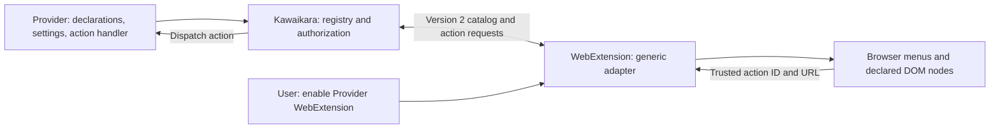
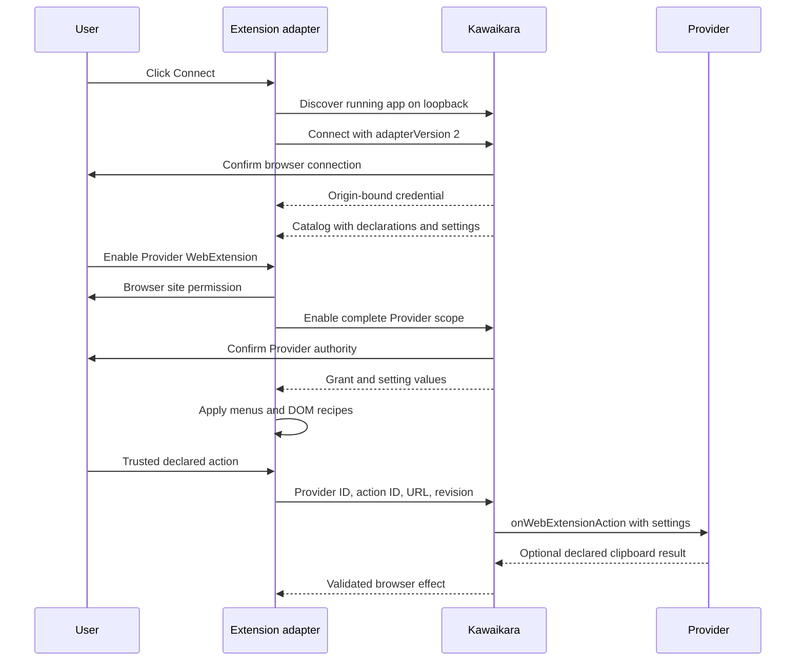
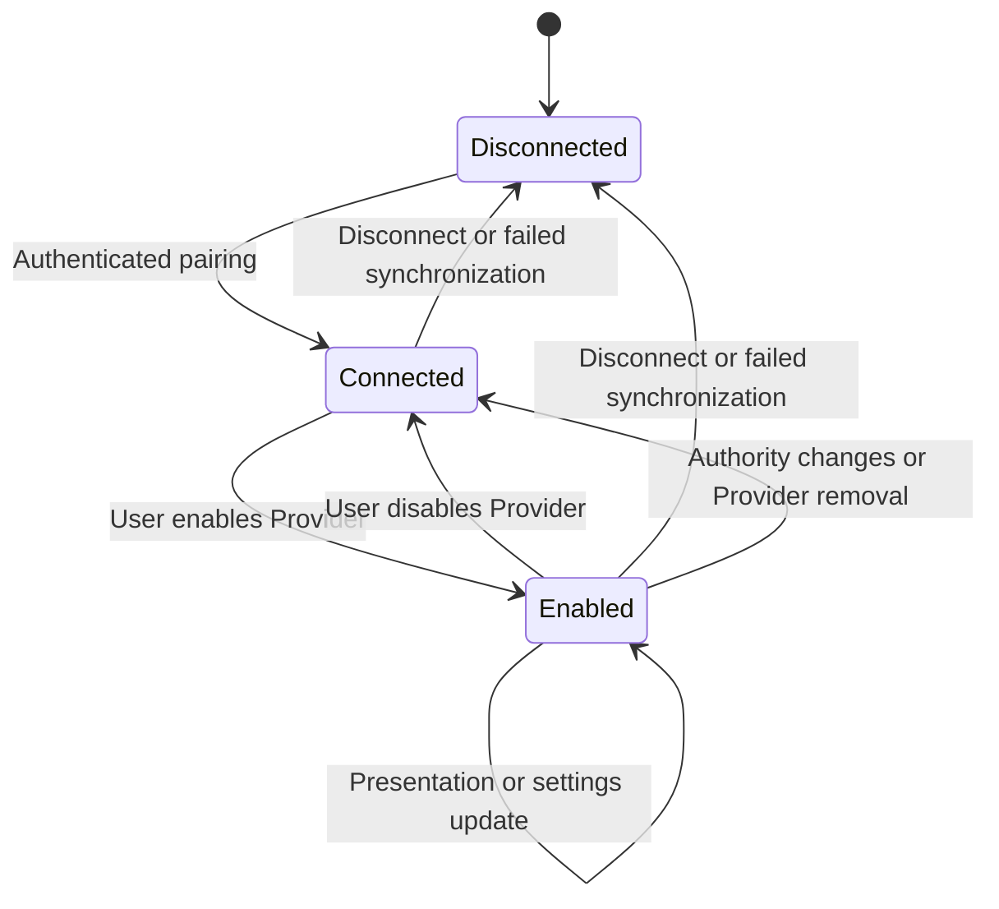
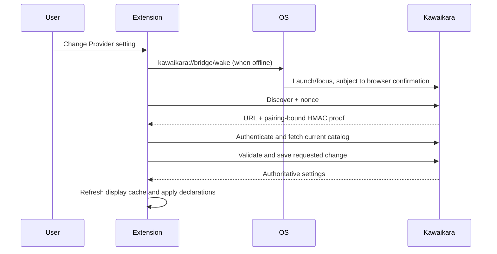
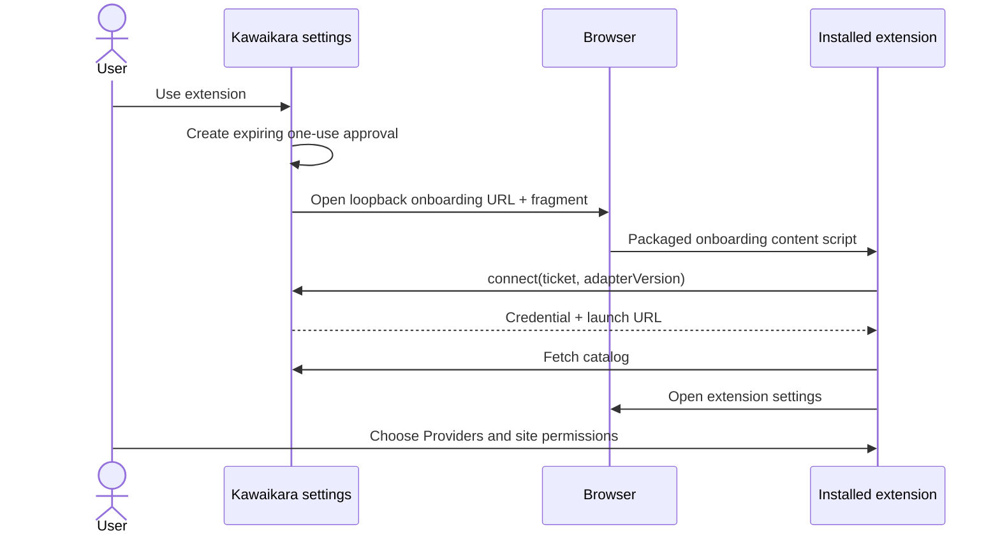
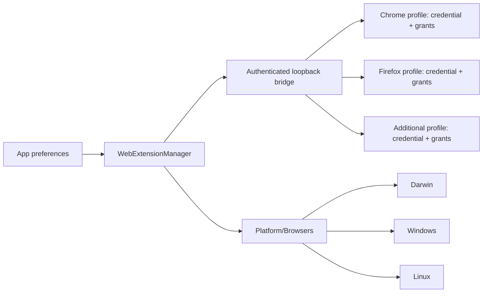

# Provider WebExtension adapter contract

**Implemented: version 2, connected-only adapter.** Kawaikara owns the Provider
registry, site declarations and executable application actions. The extension ships
only the transport, validator, generic settings UI, browser menu/DOM renderer and
bounded browser effects. It contains no built-in Provider catalog, site selectors,
share-link URLs or disconnected deep-link fallback.

## Ownership



`Main/Manager/WebExtensionManager` orchestrates Electron consent and app operations.
`Main/Functional/ExternalApps/WebExtensionBridge` authenticates and synchronizes the
catalog. `ProviderManager` publishes every registered Provider without activating
its viewer. Native integrations stay behind Platform; Electron remains a separate
application dependency. No site-specific runtime is installed in the extension.

## Provider declaration

Put this descriptor under `descriptors.webExtension` and declare `web-extension`
permission in both the Provider and Bundle. The enclosing Provider's address hosts
supply the browser origin scope. This is an illustrative descriptor, not a full
manifest:

```json
{
  "version": 2,
  "actions": [
    "save-clip"
  ],
  "actionDefinitions": {
    "save-clip": {
      "title": "Save clip",
      "handler": "provider",
      "clipboard": true
    }
  },
  "settings": [
    {
      "id": "show-menu",
      "title": "Show save menu",
      "defaultValue": true
    }
  ],
  "contextMenus": [
    {
      "id": "save",
      "action": "save-clip",
      "title": "Save this clip",
      "contexts": [
        "page",
        "video"
      ],
      "when": "show-menu"
    }
  ],
  "domActions": [
    {
      "id": "player-tools",
      "event": "contextmenu",
      "trigger": ".player",
      "target": ".player-menu",
      "layout": "button-list",
      "itemClass": "player-menu-item",
      "placement": "append",
      "items": [
        {
          "id": "save",
          "action": "save-clip",
          "title": "Save this clip",
          "when": "show-menu"
        }
      ]
    }
  ]
}
```

Action IDs are Provider-local strings, not a fixed open/copy/download enum. Each
`actionDefinitions` entry supplies the action's label and desktop handler. Built-in
handlers `open`, `download`, and `share-link` live in Kawaikara; `provider` dispatches
to the registered constructor's optional static `onWebExtensionAction`. A third-party
Provider can introduce new action IDs without releasing a new extension. Its code
never executes in the browser. The handler receives the validated URL and this
browser's Provider settings without activating a viewer:

```ts
export class ClipProvider extends AbstractUrlProvider {
    protected readonly url = 'https://clips.example/';

    static async onWebExtensionAction(request: WebExtensionInvocation): Promise<WebExtensionResult> {
        if (request.action !== 'save-clip') throw new Error('Unknown action');
        // Run Provider-owned application logic here. This code stays in Kawaikara.
        return { clipboard: request.url };
    }
}
```

`contextMenus` controls browser contexts, text and order. Link-only items use the
clicked link; other contexts use the page URL. `domActions` is an array of independent
recipes with IDs, trusted `contextmenu` or `click` events, trigger/target selectors,
optional video requirement, classes and prepend/append placement. Both supported DOM
layouts construct nodes from plain text; no remote JavaScript, raw HTML, CSS or eval
is accepted. Menu items may reference a boolean setting through `when`.

The current settings primitives are booleans. Extending the common renderer with a
new primitive requires an adapter update; adding Providers, selectors, menu entries,
settings or application actions within this contract does not. There is no hard
Provider-count or total-catalog byte cap. Full snapshots and browser resources still
have practical memory/time limits. Multiple Providers may target the same
site; every action is authorized against the selected Provider's own hosts and grant.
The single toolbar action chooses the most specific matching domain, then ID.

## Connection and enablement



1. Start Kawaikara, click **Connect to Kawaikara** in extension options, then approve
   the native app dialog. No code copy is required. Advanced code pairing remains
   available for multiple running profiles or occupied discovery ports.
2. Pairing negotiates `adapterVersion: 2`; incompatible versions are rejected.
3. The app supplies the live Provider list. Every Provider starts off until enabled.
4. Toggle **Enable <Provider> WebExtension**. The browser confirms site access and
   Kawaikara confirms the complete Provider scope, including DOM and clipboard access.
5. The extension dynamically builds settings from the Provider's schema. Values are
   stored in the desktop grant and returned with the catalog. No per-command grants
   or built-in fallback features are synthesized by the extension.
6. Turning off removes menus, registrations and existing injected nodes. Disconnect
   or detected app failure clears the live catalog; it cannot execute offline.

The options page separately displays extension loading, connection and Provider
activation. Badge LINK means connect, SET means enable a Provider, ON means at least
one active Provider, and ! means error. Scope approval is per Provider; permissions
still explicitly describe the requested host and browser effects. The current desktop
profile supports one paired browser profile. Code-free connection finds running apps;
auto-launch through Native Messaging remains planned in [External Apps](8.ExternalApps.md).
Browser host requests and permission checks use separate `http://*.host/*` and
`https://*.host/*` patterns, matching the separately declared optional schemes.
A combined `*://` request can be rejected by Chrome as absent from the manifest.

Settings can be edited while a Provider is off; they remain drafts in this options
page until the user enables it. Enabling submits those values with the permission
request. No menu is installed until both browser and desktop approval succeed.

## Synchronization and boundaries



The app computes a revision over declarations, grants and settings. Conditional
catalog polling runs on startup, user actions and the browser's 30-second alarm;
unchanged revisions return 304. Content instances have a 60-second lease. Browser
suspension can delay detection, so this is eventual synchronization. Operations always
require live app authorization; the extension clears UI when it detects disconnect.

Authorized snapshots are pushed directly to existing content renderers, which acknowledge
application synchronously. The background injects a renderer only when none responds;
this avoids duplicate refreshes removing a freshly opened menu. Injection retries
preserve existing nodes so keyboard focus and in-flight clicks survive.

Presentation changes synchronize without reapproval. Changed action handlers,
clipboard authority, hosts, DOM access presence or setting IDs invalidate the scope.
Bundle replacement defers invalidation until commit/rollback. Removing a Provider
revokes its grant. User settings update the catalog and any `when` visibility gates.

The shared contract is `packages/site-api/src/WebExtension.ts`. `npm run sync:providers`
now copies **only this contract**, never Provider data. Version 2 replaces the previous
version 1 catalog and local-grant fallback. Existing pairing credentials may reconnect,
but old scope fingerprints cannot activate a version 2 Provider; enable it again.

The bridge binds 127.0.0.1, checks Host, bearer credential and bound extension origin,
rejects web origins, limits POST bodies and verifies current revision, URL and grant.
Only extension options can enable Providers/change settings. Content requests require
the top frame and current browser-supplied URL; synthetic clicks do not dispatch.
Actions return only a validated optional clipboard string, and only when their
metadata explicitly declares clipboard authority. App handlers cannot send arbitrary
executable browser responses. Credentials stay out of content messages and catalogs.


The app retains its authenticated port and binds one free discovery port in
`43821–43830`. `/v1/discover` returns only protocol/version/loopback address.
`/v1/connect` checks the extension Origin and exact Host, limits bodies, serializes
consent and rate-limits prompts to one per ten seconds. It issues credentials only
after native app approval and rechecks revocation/shutdown while consent was pending.
Reconnecting the same extension preserves grants; a different extension clears them.
If all discovery ports are occupied, manual pairing still works. Multiple profiles
prefer the existing connection address, otherwise require disambiguation via manual
code or closing other profiles. Web origins receive no CORS permission. A local
process can forge extension headers; discovery is not OS-level identity attestation.

Routes retain the `/v1/` transport namespace: discover, connect, pair, catalog, grant, revoke, settings,
invoke, disconnect. Catalog/descriptor version 2 is independent of that URL prefix.
Per-process invocation IDs prevent duplicate actions; uncertain calls are not retried.

## Verification

Tests cover connected-only empty state, full Provider toggles, dynamic settings,
third-party action IDs, desktop static handlers without viewer activation, capability
changes, stale requests, hostile senders, 501 overlapping Providers, and payloads over
512 KiB. The isolated Chromium smoke exercises YouTube/CHZZK recipes from the app,
code-free connection, editing settings before enablement, Provider toggles, settings-driven DOM removal/restoration, clipboard and open/download
routing, trusted/synthetic clicks, updates and removal. Browser permission prompts
are pregranted only in that temporary test profile. Firefox builds, but its runtime
and real browser permission prompts require separate manual QA.

## Desktop-owned state and wake lifecycle

The extension has two responsibilities: maintain the authenticated Kawaikara bridge and
apply the Provider declarations as browser menus/DOM actions. Kawaikara owns settings,
grants and validation. The extension caches approved declarations and settings, retaining menus and DOM entry
points offline. Execution requires an authenticated desktop and current permissions.



Wake URLs accept no commands, settings or credentials and never grant permissions.
Cold wake loads the normal initial Provider; warm wake preserves the current content.
If launch is blocked, absent or times out, no setting is applied. The user can open the
app manually and retry. Cached action intents persist for at most two minutes and are consumed before dispatch.
Periodic sync and DOM refresh cannot trigger app startup. Only user activation requests wake. Local disconnect is always available.
Port migration authenticates the discovered host before transmitting stored credentials.


### Pairing stores the desktop launcher

Approved `connect`/`pair` responses include `launchUrl: kawaikara://bridge/wake`.
The adapter accepts only this exact URI and stores it with the pairing credential.
OS protocol registration (already performed at application startup) locates the executable,
including portable installations where registration succeeds. A moved portable executable,
unsupported development registration or a different default profile requires opening the
paired app manually. The URI is a launch hint, not identity: authenticated discovery proves
possession of the existing pairing token. Legacy connections must pair again to learn the launcher.

```mermaid
sequenceDiagram
  actor User
  participant Adapter as Extension adapter + cache
  participant OS
  participant App as Paired Kawaikara
  User->>App: First connection approval
  App-->>Adapter: Credential + launchUrl + Provider catalog/grants
  Note over Adapter,App: App may now be closed
  User->>Adapter: Click cached Provider menu / DOM action
  Adapter->>Adapter: Persist bounded intent; open internal launch page
  Adapter->>OS: Saved launchUrl (browser may ask confirmation)
  OS->>App: Start registered executable
  Adapter->>App: Discover + nonce; verify HMAC proof
  Adapter->>App: Fetch current authorized catalog
  Adapter->>Adapter: Check revision, host permission and original tab; consume intent
  Adapter->>App: Invoke once
```

The internal launch page contains only an opaque request ID. It polls for 90 seconds;
requests expire after two minutes, survive worker suspension, and are deleted on cancel,
timeout or disconnect. Closing the page stops polling. No startup job replays them.
Changed revisions or source tabs require a new click. A lost invoke response is never
retried automatically. Browser/OS prompts and executable availability remain outside the
adapter's control; a visible launch button and manual-start instructions remain available.


### Desktop-initiated onboarding

The **Use extension** settings action creates a one-use, two-minute handoff ticket and
opens `http://127.0.0.1:<bridge-port>/extension-connect#<ticket>` in the default browser.
The exact loopback page is public but contains no secret; it has no page scripts, a
restrictive CSP, no framing and no referrer. A packaged extension content script sends
only a signal to its worker, which reads the ticket from the browser-supplied top-frame
URL and checks the current tab. It never accepts a page-supplied endpoint or credential.

The worker calls `connect` with the handoff ticket. First/same-browser pairing uses the
app-button consent; replacing a different paired browser still requires confirmation.
Invalid, expired, superseded or consumed tickets fail without falling back to a prompt.
Revocation, shutdown and manual setup invalidate the ticket. Merely opening onboarding
does not revoke current credentials. The worker stores the resulting credential and
launch URL, synchronizes the catalog and opens extension options for Provider consent.
It returns only success to the page and the content script clears the URL fragment.
No fixed extension ID or published-store ID is required. Extensions must already be
installed and enabled in the browser opened by the OS; installation is not automated.



Browser matching follows the [Chrome content script model](https://developer.chrome.com/docs/extensions/develop/concepts/content-scripts)
and [loopback match patterns](https://developer.chrome.com/docs/extensions/develop/concepts/match-patterns).


### Development runtime and adapter reload diagnostics

Web Extension controls are in **Advanced** preferences. Unpackaged macOS/Linux does
not register the generic Electron bundle as the protocol client. The bridge advertises
`launchUrl: null` in pairing replies and catalogs, replacing old cached launch hints.
The authenticated `POST /v1/wake` focuses an already running app without launching an
OS handler. Offline development requires manual startup (`pnpm dev`) or a packaged build.

Options and workers negotiate `uiVersion: 1`. Incompatible/missing response fields
produce reload instructions instead of an undefined `.find` error. The loopback page
loads a same-origin status timer: after ten seconds without the packaged content script,
it explains how to reload the extension and retry. Its status script cannot pair or read
credentials. Reloading an unpacked extension and reopening old options/onboarding tabs
is required after updating its manifest or worker.


### Preferences UI and instance identity (0.6.3)

Supported browsers are Google Chrome and Mozilla Firefox only. After successful app-initiated
pairing, the worker replaces the originating onboarding tab with its runtime-generated
`options.html` URL; it no longer opens a second tab. Failed pairing stays on the original page.

The preferences UI uses React and the same KawaiUI Panel/Button/Switch/Input/Badge components
as Kawaikara. Provider cards show domain and capability tags, searchable by name/ID/domain.
Connect and Disconnect are mutually exclusive. Green/yellow/red badges include text for
connected, checking/offline, and unpaired states. The modal uses native dialog focus handling.

Authenticated catalogs optionally include `desktop` (name, version, channel, runtime,
appPath and a hash-based profileId). Public discovery does not include this data. The modal
shows cached identity explicitly when offline; old apps without metadata show an update hint.
Credentials remain in the worker and never appear in the preferences response or DOM.

## Independent browser connections

The bridge persists a collection of clients, each with an opaque connection ID, extension
origin, profile instance ID, token, grants, settings and installed extension metadata.
Legacy singleton state migrates into one record. Discovery uses origin + instance ID;
authenticated requests use origin + token. Catalog revisions include only that client's
grants. Adding a connection or generating a manual code preserves all existing clients.

The app can revoke one ID or all IDs. Revoked credentials remain as tombstones to prove
revocation to offline clients using a request nonce and HMAC; they cannot authorize actions.
The adapter distinguishes verified revocation from a stopped app, clears descriptors and
launch authority, and returns to the disconnected settings UI. An arbitrary loopback 401
cannot erase a user's paired app or inject replacement credentials.



Platform exposes supported-browser discovery and validated pairing URL launch. Renderer
callers supply only allowlisted browser IDs, never executable paths or command arguments.
Only Chrome and Firefox are listed. The default connection action uses the OS browser;
Add connection uses the selected installed browser. Browser profile selection remains in
the browser; codes can target any open profile.
