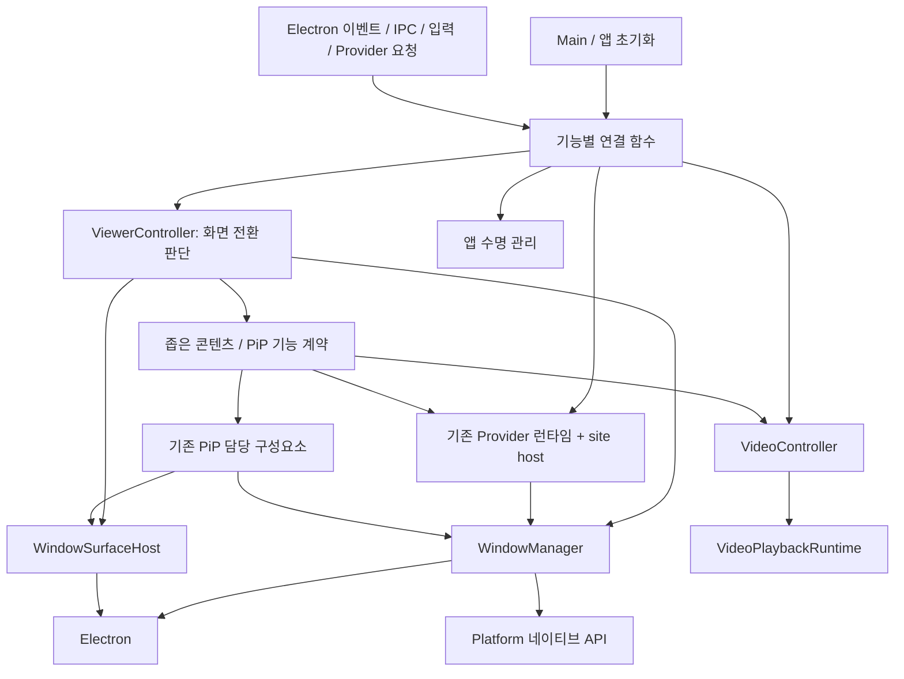
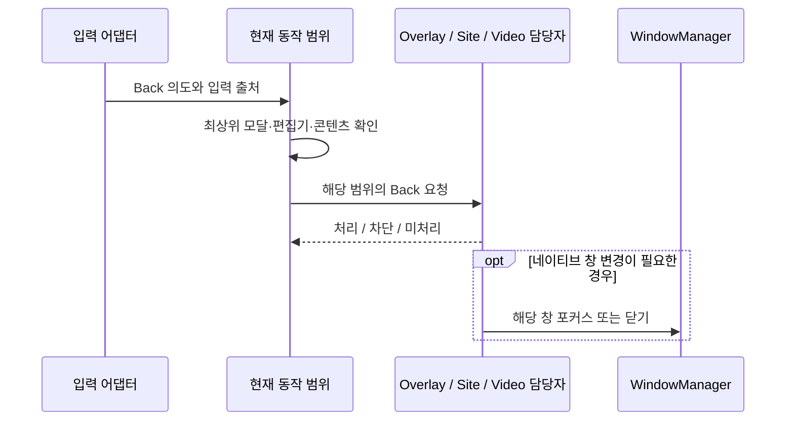

# 창 소유권과 애플리케이션 동작 조정

**상태: 소유권 분리 구현 완료 (2026-10-20).** `Functional/Viewer/ViewerRuntime.ts`가 창·화면 전환·Provider 호스팅·Video·PiP·입력·진단 도구·종료 준비의 소유자를 조립한다. 아래는 설계 원칙과 이전 기준이며 실제 구현은 다음과 같다.

| 담당 | 구현 |
| --- | --- |
| 네이티브 메인 창 | `Manager/WindowManager.ts` |
| 화면 전환과 오버레이 | `Functional/Viewer/ViewerController.ts` |
| 기존 Provider 런타임의 사이트 호스트 | `Functional/Bundle/Provider/ProviderSiteHost.ts` |
| 유지되는 비디오 렌더러와 요청 | `Functional/Video/VideoController.ts` |
| 기존 UnifiedPictureInPictureManager를 사용하는 PiP 조정 | `Functional/Viewer/ViewerPictureInPicture.ts` |
| 입력·진단 도구·종료 준비 | `Functional/Viewer/ViewerInput.ts`, `ViewerDiagnostics.ts`, `ViewerLifecycle.ts` |
| 물리적인 화면 부착 | `Functional/Window/WindowSurfaceHost.ts`와 기존 이동 보조 모듈 |

구현에서는 ProviderManager의 기존 순차 활성화 큐와 현재 WebContents 식별 검사를 유지했다. 별도의 활성화 스케줄러를 추가하지 않는다. 메인 창은 WindowManager가 소유하고 보조 PiP·팝업·분리 창은 기존 범위별 호스트를 재사용한다. 재생 복구는 VideoController로 돌아오며, 연결 함수는 해제 함수를 반환한다. IPC 호출자는 필요한 소유자만 받는다. 기존 API를 대신 전달하는 프로덕션 facade는 남기지 않았다.

[English 원본](../../../Architecture/10.WindowOwnership.md)

## 1. 결정과 범위

`WindowManager`는 **네이티브 창을 관리하고, 그 안에 표시되는 앱 기능은 관리하지 않는다.** 이벤트 등록을 옮겨도 콜백이 WindowManager에 Provider 선택, Back 해석, 탐색 권한 판단, 비디오 제어를 맡긴다면 책임 분리는 끝나지 않는다.

다음 세 가지를 구분한다.

1. **창 조작:** 생성, 위치, 크기, 표시, 포커스, 제거.
2. **앱의 판단:** 활성 콘텐츠, 오버레이, 탐색 동작, 미디어 표시 방식과 화면 전환.
3. **연결:** Electron·IPC·입력·Provider 신호를 담당 기능에 전달.

범용 EventManager, PipelineManager, 전역 이벤트 버스나 서비스 로케이터를 추가하지 않는다. 연결 모듈은 의존성을 명시하고 연결 해제를 제공하는 함수로 만든다. Controller는 실제 상태와 수명을 소유할 때만 둔다. 초기화 코드는 구성요소를 연결하며 기능 자체를 구현하지 않는다.

Renderer/Preload IPC와 `site-api`의 공개 계약, Provider/Plugin 설정과 권한, 비디오 재생 유지, PiP 동작, 시작 위치 및 업데이트 실패 복구는 유지한다. 기능 재설계나 새로운 네이티브 구현은 이번 범위가 아니다.

## 2. 소유자와 상태

| 소유자 | 관리하는 것 | 관리하지 않는 것 |
| --- | --- | --- |
| `WindowManager` | 네이티브 창 목록·수명, 위치·크기·모니터 배치, 표시·전체화면, 요청/실제 항상 위 상태, 포커스 조작 | 활성 Provider, 오버레이 경로, 입력 편집 상태, 탐색 기록, 비디오 요청, mpv, 권한, 앱 종료 순서 |
| `WindowSurfaceHost` | 전달받은 `WebContentsView`의 물리적 부착·순서·크기·포커스, 호스트 이동 시 소유권 확인 | 사이트/비디오 렌더러 생성, 활성 기능 선택, URL 로딩, 콘텐츠 의미 판단 |
| `ViewerController` | 활성 콘텐츠 식별자, 오버레이 경로, 포커스 대상 선택, 화면 전환 순서 | Provider 세션·요청 가로채기, 디코딩, 설정 저장, 범용 IPC 처리 |
| Provider 런타임 / site host | 기존 Provider/Plugin 수명과 사이트 세션, 범위가 제한된 `SiteContext`, 탐색 정책, 브라우저 식별 정보, 페이지 파이프라인, 외부 로그인 | 네이티브 창 목록, 앱 오버레이 경로, mpv |
| `VideoController` | 유지되는 비디오 렌더러의 수명, 대기/현재 열기 요청, 미디어 표시 정보, 렌더러 명령과 교체 | 네이티브 창 배치, Provider 권한, 디코더 내부 구현 |
| `VideoPlaybackRuntime` | mpv 서비스, 재생 연결, 지원 기능 조회, 초기화 감시와 fallback | 앱 라우팅, Video를 여는 시점, 네이티브 호스트 선택 |
| 기존 PiP 담당 구성요소 | PiP 세션·허용 여부, 이동/복귀 트랜잭션, 배치 정책, 자막 및 Plugin 연동 | Provider 선택, 다른 앱 오버레이, 별도 mpv 구현 |
| 입력 라우팅 / `ShortcutManager` | 입력 정규화, 편집기·모달 우선순위, 설정된 단축키 해석 | 창 수명, Provider 수명, 재생 서비스 수명 |
| 앱 수명 관리 | 시작, 종료/업데이트 준비, 정리 순서, 업데이트 실패 복구 | 기능 내부 구현, 직접적인 키 비교 |

`WindowSurfaceHost`는 별도의 앱 매니저가 아니라 창 관련 보조 모듈이다. 적절한 부분은 기존 `DetachableWindowSurface`, `WebContentsViewTransfer`를 확장한다. 렌더러의 수명은 기능 소유자가 계속 관리한다. 화면을 떼어내는 조작이 렌더러나 재생 세션을 암묵적으로 제거해서는 안 된다.

`ProviderManager`, `SitePagePipeline`, 기존 PiP 구현을 유지한다. WindowManager에 있는 관련 상태를 이 소유자 또는 site-host 보조 모듈로 옮기며, Provider 런타임을 이중으로 만들지 않는다. ViewerController는 표시·일시 중단·해제 같은 좁은 콘텐츠 기능만 받는다. 모든 기능 매니저를 생성자에 주입받는 새로운 거대 매니저가 되어서는 안 된다.

항상 위에 표시의 네이티브 상태 감지와 Platform 정책 적용은 WindowManager에 남길 수 있다. 다만 PiP 활성화처럼 앱 기능에 따른 제한은 수명이 정해진 표시 제약으로 전달한다. WindowManager가 PiP 상태를 직접 조회하지 않는다. 네이티브 창 상태와 ViewerController의 활성 콘텐츠 상태를 중복 저장하지 않는다.

## 3. 의존 관계와 연결 수명

화살표는 호출 가능 방향이지 매니저 전체를 넘겨도 된다는 뜻이 아니다. 예를 들어 사이트 팝업에는 범위가 제한된 창 생성 기능만 준다. Provider에는 창 목록이나 Electron 객체를 노출하지 않는다. 완료 통지는 초기화 시 전달한 콜백으로 돌려주며, 하위 모듈이 상위 Controller를 역으로 import하지 않는다.

- WindowManager는 ProviderManager, ViewerController, VideoController, IPC 기능 모듈, ShortcutManager, `electron-mpv-video`를 import하지 않는다.
- 네이티브 플레이어 서비스는 재생 모듈만 import한다. OS 고유 기능은 기존 Platform API를 사용한다. Electron은 계속 별도의 의존성이며 Platform 아래로 넣지 않는다.
- 이벤트가 발생할 때 현재 상태를 읽는다. 등록 시점의 Provider·렌더러·설정을 캡처해 계속 사용하지 않는다.
- 연결 함수는 여러 번 호출해도 안전한 해제 함수를 반환한다. 수명을 앱·창·렌더러·Provider 활성화 중 하나로 명시하고, 등록 실패 시 앞서 등록한 연결도 해제한다.
- 렌더러를 교체할 때 기존 연결 범위를 먼저 해제한다. 전역 screen/input 구독은 명시적으로 제거한다. 창을 제거해도 다른 객체에 걸린 구독이 자동 해제되는 것은 아니다.

앱 수명 동안 상태를 소유하더라도 구현 위치는 기능 책임을 따른다. 화면 전환·입력·PiP 조정·진단·종료 준비는 `Functional/Viewer`, VideoController는 `Functional/Video`, ProviderSiteHost는 `Functional/Bundle/Provider`에 둔다. 이들은 `Functional/Viewer/ViewerRuntime.ts`가 조립하는 내부 구성 요소이며 별도의 전역 Manager가 아니다. WindowManager는 `Manager`에 유지한다. 창 조작은 `Functional/Window`, IPC는 `Functional/IPC`, 앱 시작은 기존 초기화/DI 모듈에 둔다. `Main` 바로 아래에 구현 파일을 추가하거나 범용 `Pipelines` 디렉터리를 만들지 않는다.

## 4. 이벤트와 명령 흐름

### Back과 입력

기본 편집 동작이 우선이다. 최상위 모달은 뒤로 갈 곳이 없어도 동작을 차단할 수 있다. **차단은 미처리와 다르다.** 차단된 입력이 아래쪽 페이지로 흘러가면 안 된다.

오버레이 Back, 사이트 기록 Back, 비디오 디렉터리 Back, 브라우저의 물리적인 뒤로가기 버튼은 라우팅 후 서로 다른 명령이다. 기존 브라우저 버튼의 비디오 디렉터리 탐색 조건을 유지하며, 이번 분리를 계기로 다른 화면에 새 동작을 추가하지 않는다.

WindowManager는 Escape, Tab, Space, Back의 의미를 판단하지 않는다. 렌더러가 소유한 팝업과 미저장 변경 확인도 그대로 유지한다. 필요한 경우 닫기 요청은 렌더러의 결정을 기다려야 하며, 무조건 숨기는 조작으로 바꾸지 않는다.

### Provider 활성화와 사이트 파이프라인

활성화 권한은 ProviderManager에 남긴다. site-host 기능은 세션과 화면을 준비하고, 권한 범위가 제한된 컨텍스트와 기존 `SitePagePipeline`을 구성한다. ViewerController는 이 기능을 통해 표시 전환을 조정하며 파이프라인 내부를 다루지 않는다.

활성화마다 식별자/리비전을 둔다. 비동기 준비·로딩·주입 이후 결과를 적용하기 전에 활성화가 여전히 유효한지 확인한다. 교체된 컨텍스트의 기능 접근은 즉시 철회한다. 이전 Provider에서 늦게 온 탐색·요청 변환·팝업 생성이 새 화면에 영향을 주면 안 된다.

PiP 허용 여부는 계속 확정된 메인 프레임 탐색으로 판단한다. SPA의 중간 주소로 해제하지 않으며, 서브프레임의 Provider 동작 스킴에 대한 기존 제한도 유지한다.

### 비디오와 PiP

승인된 비디오 열기 요청은 VideoController가 받는다. 요청 식별자, 기존 렌더러 재사용, 렌더러 명령을 소유하고 ViewerController에 Video 표시와 포커스 선택을 요청한다. 네이티브 창을 표시·이동·포커스해야 할 때만 WindowManager를 사용한다. 다운로드 작업은 기존 담당자가 유지한다.

PiP 담당자는 활성 콘텐츠 기능과 Provider/Plugin 설정을 통해 전환 가능 여부를 판단한다. 호스트 생성과 화면 이동이 성공한 후 표시 상태를 확정한다. 실패하면 마지막 유효 호스트와 포커스로 복구한다. 유지되는 비디오 화면을 PiP로 옮겼다는 이유로 mpv를 다시 생성하지 않는다.

재생 복구는 VideoController에 렌더러 교체를 요청한다. 요청 대상이 아직 소유한 렌더러인지, 종료/PiP 때문에 교체가 금지됐는지 확인한다. 백엔드 선택은 PlaybackRuntime, 렌더러 교체는 VideoController, 재부착은 표시 계층이 맡는다. PlaybackRuntime에서 WindowManager로 직접 돌아가는 복구 콜백은 없앤다.

## 5. 전환, 설정과 종료

전역 큐 하나 대신 소유자별 전환을 사용한다. ViewerController는 화면 전환, Provider 런타임은 활성화, VideoController는 렌더러 생성/복구를 조정한다. 소유자 간 호출 방향을 고정해 서로의 큐 완료를 기다리는 교착을 만들지 않는다.

새 활성화는 리비전으로 이전 작업을 대체한다. 취소 가능한 작업은 취소하고, 취소 불가능한 Electron 작업이 늦게 완료되더라도 상태를 확정하지 못하게 한다. PiP 진입/복귀는 화면 이동이나 렌더러 교체와 겹치지 않는다. 여러 소유자의 불리언 조합 대신 준비·표시·복귀·해제 상태를 명시한다.

PreferenceManager가 설정을 저장하고 각 소유자에게 필요한 값만 전달한다. 시작 크기는 WindowManager, 단축키는 ShortcutManager, PiP 정책은 PiP 담당자, 테마·언어·Provider 설정은 해당 기능 담당자가 받는다. 설정 저장소를 중복하거나 Plugin 설정을 초기화하지 않는다.

앱 종료 또는 업데이트 준비 순서는 다음과 같다.

1. 네이티브 닫기를 동기적으로 막고 앱 수명 관리가 진행 여부를 결정한다. WindowManager가 직접 미디어 정리를 호출하지 않는다.
2. 신규 기능 요청 수락을 중단하고 활성화 범위를 철회한다. 정리에 필요한 내부 복귀 동작은 계속 가능해야 한다.
3. 네이티브 호스트를 제거하기 전에 일반 창 크기·위치와 PiP 위치를 기록한다.
4. PiP를 복귀/종료하고 콘텐츠 정리를 수행한다. Video WebContents 제거 전에 mpv 연결을 해제한다. 사이트 팝업과 외부 로그인 세션도 정리한다.
5. 연결 범위와 네이티브 창, 앱 단위 서비스를 해제한다. 중간 실패가 있어도 나머지 소유자의 정리를 시도하고 오류를 기록한다.

반복된 닫기 요청은 준비 작업 하나를 공유한다. 업데이트 실패 시에는 표시 상태와 요청 수락을 복구하되 구독을 중복 등록하지 않는다. **되돌릴 수 있는 업데이트 준비와 최종 종료를 동일한 비가역적 dispose로 합치지 않는다.**

## 6. 현재 코드의 이전 대상

| 현재 WindowManager 책임 | 목표 소유자 |
| --- | --- |
| `createWindows`, 시작 배치, 크기/전체화면/네이티브 항상 위 | WindowManager. 오버레이·콘텐츠 생성은 제외 |
| `connectWindowInput`, `dispatchWindowInput`, `setEditingState` | 입력 연결과 동작 범위. 편집 상태는 해당 렌더러 범위 소유 |
| 오버레이 표시/경로, 활성 콘텐츠의 포커스 대상 선택 | ViewerController. 실제 포커스 조작은 창/화면 보조 모듈 |
| `createSiteContext`, `createSiteViewer`, `configureSiteSession`, 브라우저 식별 정보 | 기존 Provider 런타임의 site-host 보조 모듈 |
| `setSiteHandlers`, `SitePagePipeline`, 탐색/요청 정책 | Provider 활성화 범위와 사이트 연결 |
| `activateSiteView`, 로딩 상태와 화면 인계 | 사이트 담당자가 준비하고 ViewerController가 표시를 확정 |
| 비디오 요청 큐, 로컬 파일 선택, `ensureVideoView`, `replaceVideoPlaybackView` | VideoController. 파일 대화상자/필터도 Video 기능 아래 유지 |
| `recoverVideoPlaybackRenderer`, 준비 완료, 재생 지원 기능 전달 | IPC가 Video 담당자/런타임에 직접 연결 |
| 내장 비디오와 Provider PiP 조정 | 콘텐츠별 기능 계약을 사용하는 기존 PiP 담당자 |
| 외부 로그인·사이트 팝업·DevTools·로그 뷰어 기능 | 각각의 기능 호스트. 네이티브 생성/배치는 창 기능 사용 |
| 업데이트 준비와 메인 창 종료 순서 | 기존 앱 수명 관리가 명시적인 참여자 작업을 호출 |

한 메서드 안에서도 책임을 나눠야 한다. 의존성 전체를 유지한 채 메서드만 다른 파일로 옮기는 것으로는 경계가 정리되지 않는다.

## 7. 이전 단계와 검증

1. **소유권과 수명 범위 정의:** 현재 호출자와 동작을 목록화하고 창/화면/콘텐츠의 좁은 계약과 연결 해제를 정의한다. 공개 IPC·Provider 계약은 유지하고 금지된 의존성 검사를 추가한다.
2. **입력·화면 전환 이전:** 의미 기반 입력을 현재 범위로 전달하고 활성 콘텐츠/오버레이 판단을 ViewerController로 옮긴다. 편집, 모달, 미저장 변경, 포커스, 작은 화면을 검증한다.
3. **Provider 호스팅 이전:** 컨텍스트·세션·파이프라인·외부 로그인 소유권을 이전하고 DI의 ProviderManager 팩토리를 다시 연결한다. 권한, 오래된 활성화 차단, 브라우저 프로필 격리, 팝업 정책, 확정 탐색, Plugin 켜기/끄기를 검증한다.
4. **Video와 PiP 연결 정리:** 요청/렌더러 수명을 VideoController로 옮기고 PlaybackRuntime과 기존 PiP 정책을 연결한다. 재생 위치 유지, 열기 요청, fallback, 전환 실패 및 해제를 검증한다.
5. **앱 수명 조립 이전 및 임시 facade 제거:** IPC·단축키·설정·업데이트·시작 코드가 실제 소유자를 호출하게 한다. 필요하면 WindowManager 밖에 임시 전달 facade를 두되 이전 완료 후 제거한다. 반복 시작/종료와 업데이트 실패 복구를 검증한다.

각 단계는 앱을 실행할 수 있고 독립적으로 검증할 수 있어야 한다. 기존 Node/Electron 테스트와 포커스·모달 닫기·PiP·배치 UI 검증을 사용한다. 타입 검사와 빌드만으로 네이티브 표시의 올바름을 보장하지 않는다.

완료 조건은 WindowManager에 Provider 식별자, 오버레이 경로, 비디오 열기 요청, 편집 상태, 페이지 파이프라인, 입력 해석, 재생 서비스가 없는 것이다. 변경 가능한 상태마다 소유자가 하나이고, 장기 연결마다 해제 범위가 있으며, 창 종료가 WindowManager의 기능 목록에 의존하지 않아야 한다.

## 8. 유지할 제약

이 설계는 내부 소유권 변경이며 새로운 공개 확장 API가 아니다. 범용 문자열 명령 레지스트리 대신 타입이 있는 콜백과 기존 IPC를 사용한다. 새 클래스를 만들기 전에 기존 매니저와 보조 함수를 재사용한다. 네이티브 창 핸들은 신뢰할 수 있는 Main 코드 안에 둔다. 의미 기반 명령으로 바꿨다고 권한이 생기는 것은 아니므로 기존 IPC·기능 경계의 검증을 유지한다.

정확한 타입/파일 이름은 구현 단계에서 정하되 편리한 WindowManager 접근을 유지하기 위해 소유권 결정을 되돌리지 않는다. 콜백에 앱 컨테이너 전체가 필요하다면 기능 계약이 너무 넓은 것이다.
