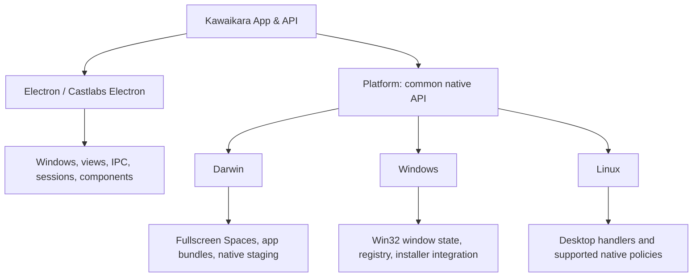
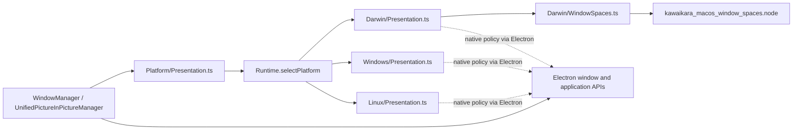
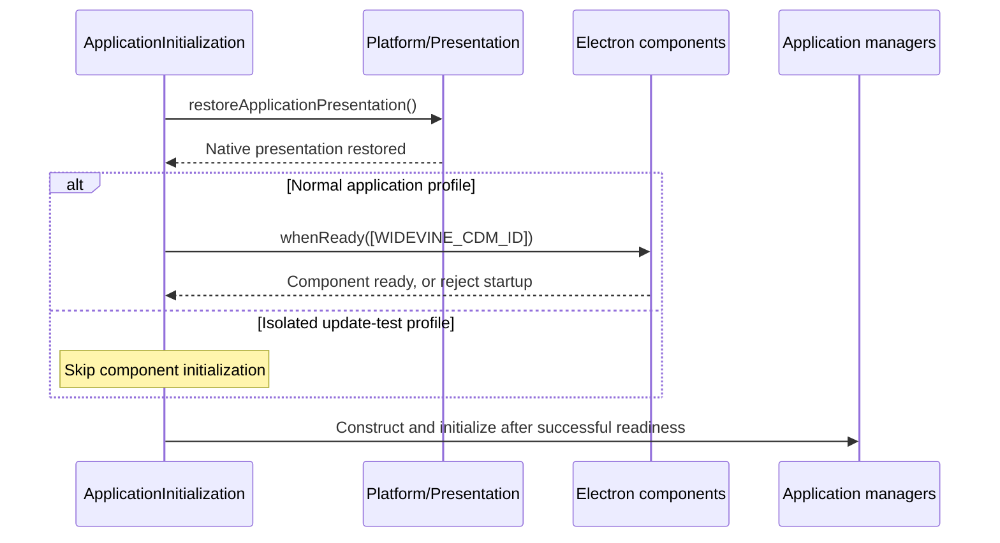

# Platform과 네이티브 연동

## 역할

Kawaikara는 **Electron과 Platform을 나란히 의존**합니다. 앱 코드는 프로세스와
보안 모델이 허용하는 곳에서 Electron API를 직접 사용할 수 있습니다. Platform은
네이티브 OS 기능을 공통 API로 제공하며, 호출부가 Darwin·Windows·Linux 구현을
직접 선택하지 않게 합니다.



화살표는 앱의 의존 관계를 나타냅니다. Electron 자체가 내부적으로 네이티브 코드를
쓴다고 해서 그 API를 Platform으로 우회할 필요는 없습니다. 기존 renderer 격리,
preload bridge, site-api capability 제한은 유지됩니다. 이 구조가 프로세스에
새로운 권한을 부여하지는 않습니다.

## 기능의 소유자 결정

| 작업 | 소유자와 진입점 |
| --- | --- |
| `BrowserWindow`·`WebContentsView` 생성, IPC·dialog·session 사용 | 앱 코드가 Electron을 직접 사용 |
| Castlabs Widevine component 준비 대기 | `Functional/App/ApplicationInitialization.ts`가 `components.whenReady`를 직접 호출 |
| 네이티브 PiP 작업 공간·활성화 정책 적용, topmost 상태 복구 | `Platform/Presentation.ts` |
| 네이티브 addon으로 외부 전체 화면 소유권 관찰 | `Platform/ExternalFullscreenMonitor.ts` |
| 설치 프로그램이 관리하는 데이터 경로 읽기, 파일시스템 루트 조회 | `Platform/Storage.ts` |
| 네이티브 서명 검사 설정과 OS 업데이트 설치 전 준비 | `Platform/Updates.ts` |
| 네이티브 등록 정보를 통한 외부 앱 검색·설치·실행 | `Platform/ExternalDownloader.ts` |
| PiP 진입 시점 결정, 사용자 동의, 설정 저장, renderer 알림 | 앱 manager와 functional helper |

Platform 구현 안에서도 Electron을 사용할 수 있습니다. Darwin 창 표시는 Electron의
활성화·작업 공간 API와 네이티브 fullscreen Spaces bridge를 조합합니다. Windows는
Electron 창 메서드를 사용해 네이티브 topmost 상태를 복구합니다. 이 함수들이
Platform에 속하는 이유는 OS별 네이티브 정책을 담당하기 때문입니다. 모든 Electron
API를 감쌀 필요는 없으며, Castlabs component 관리는 Platform의 책임이 아닙니다.

## 구현 구조

`src/Main/Platform` 아래에는 세 디렉터리만 둡니다.

```text
Main/
├── Functional/App/ApplicationInitialization.ts  # Direct Electron component readiness
├── Manager/                                    # Application orchestration
└── Platform/
    ├── Presentation.ts                         # Common native feature API
    ├── Storage.ts, Updates.ts, Graphics.ts      # Common native feature APIs
    ├── ExternalFullscreenMonitor.ts            # Common monitor factory
    ├── DefaultBrowser.ts, DefaultVideoApp.ts
    ├── ExternalDownloader.ts, Keyboard.ts, Information.ts
    ├── Runtime.ts                              # Selects the running OS implementation
    ├── ...                                     # Shared contracts and support functions
    ├── Darwin/                                 # Private Apple desktop implementations
    ├── Windows/                                # Private Windows implementations
    └── Linux/                                  # Private Linux implementations
```



`Runtime.selectPlatform`은 기능 모듈을 평가할 때 현재 OS 구현 하나를 선택합니다.
`darwin`, `win32`, `linux`를 지원하며 다른 OS에서는 명시적으로 실패합니다. 네이티브
addon은 기능에서 필요할 때 로드합니다. 앱은 `Platform/Presentation` 같은 루트
기능 모듈을 import하고 OS 디렉터리를 직접 참조하지 않습니다. OS 구현끼리 서로
참조하거나 앱 manager에 의존하지 않습니다. 공통 계약과 재사용 helper는 Platform
루트에 둡니다.

## 호출 흐름

앱 초기화는 두 의존성을 각각 사용합니다. 업데이트 테스트 프로필에서 component
초기화를 생략하는 기존 정책도 앱 코드가 소유합니다.



같은 작업 안에서도 두 API를 함께 사용할 수 있습니다. 다음 예제는 Electron 준비가
끝난 뒤 실행하며, 창의 수명은 앱이 관리합니다.

```ts
import { BrowserWindow } from 'electron';
import { configurePictureInPictureWindow } from '../Platform/Presentation';

const window = new BrowserWindow({ show: false, frame: false });
configurePictureInPictureWindow(window);
```

호출부는 Electron 객체를 생성하고 네이티브 표시 정책을 Platform에 맡깁니다.
`process.platform`을 검사하거나 `Darwin/Presentation`을 직접 import하지 않습니다.

## 기능 지원과 한계

공통 API가 모든 OS에서 같은 기능을 지원한다는 뜻은 아닙니다. 사용자 지정 데이터
위치와 네이티브 기본 동영상 앱 설정은 현재 Windows에서 지원합니다. 외부 다운로더
자동 설치는 Darwin 앱 번들과 Windows 설치 프로그램을 지원하며, Linux에서는
등록된 데스크톱 handler를 검색하고 실행할 수 있습니다. 명시적인 외부 전체 화면
감시는 Windows에 구현되어 있고, Darwin·Linux는 미지원 monitor 객체를 반환합니다.
네이티브 비디오 backend는 배포 중인 Windows x64와 Darwin arm64 조합에 한정됩니다.

호출부는 `supportsCustomDataLocation()`, `hasNativeVideoBackend()` 같은 기능 조회
함수나 monitor의 `supported` 속성을 사용합니다. 네이티브 작업에 OS 이름을 다시
전달할 필요는 없습니다. 로그, host metadata, 상태 결과에는 OS 이름을 담을 수 있습니다.

## 검증과 확장

- 네이티브 연동이 필요하면 Platform 루트에 공통 기능 API를 추가합니다.
- OS 차이는 `Darwin`, `Windows`, `Linux` 안에 구현하고, 미지원 기능은 명시적으로 처리합니다.
- 앱 상태, 사용자 동의, 수명 주기 조율은 앱 코드가 담당합니다.
- Castlabs component API를 포함한 Electron 기능은 Electron을 직접 사용합니다.
- `tests/Unit/platform-boundary.test.cjs`는 디렉터리와 import 경계를 검사합니다.
- `tests/Unit/platform-policy.test.cjs`는 OS를 모의한 환경에서 공통 API의 네이티브 정책을 검사합니다.
- `tests/Unit/application-initialization.test.cjs`는 Electron 준비 대기, 실패 전파, 업데이트 테스트의 생략 정책을 검사합니다.

이 테스트들은 코드 조합과 정책을 검증합니다. 네이티브 addon, 전체 화면 전환,
설치 프로그램 실행은 실제 OS에서도 별도로 확인해야 합니다.
