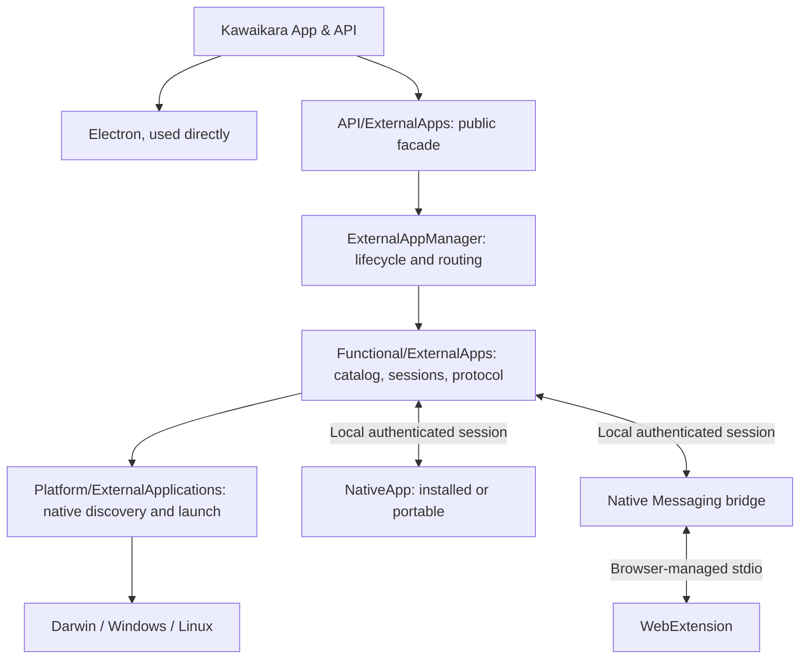
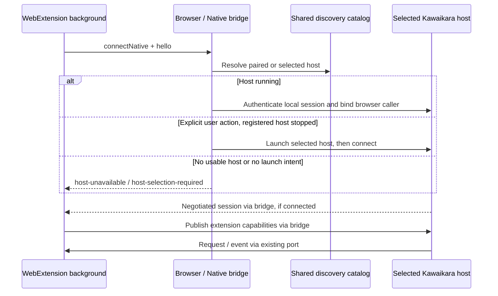
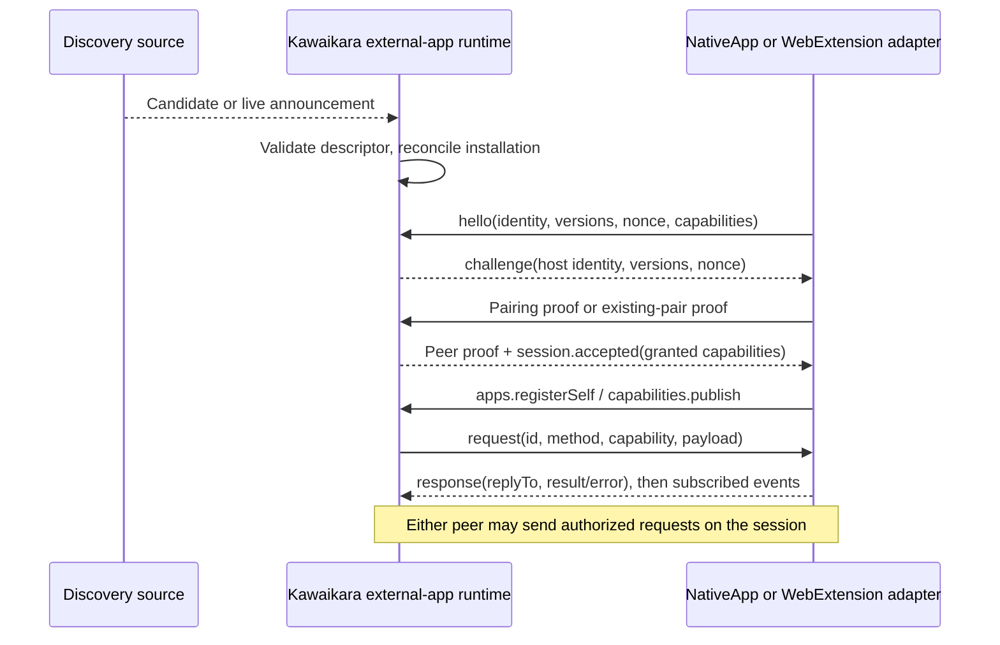

# 외부 앱: 발견과 통신

> Provider가 제공하는 WebExtension 기능은 실행 중인 앱 자동 검색과 인증 루프백 연결로 구현했다. [Provider WebExtension](9.ProviderWebExtension.md)을 참고한다. 아래의 일반 검색과 Native Messaging은 여전히 설계 단계다.

**상태: 구현 전 설계안.** `dev` 브랜치의 다음 외부 앱 계층을 정의합니다. 아래의 새
디렉터리, 등록 방식, manifest, endpoint, 메시지는 제안입니다. 현재 구현된 기능은
기존 다운로더 callback과 확장의 deep link이며, 이 설계가 이미 제공된다는 뜻은 아닙니다.

## 1. 두 가지 앱 타입과 하나의 프로토콜

`NativeApp`과 `WebExtension`은 Kawaikara 외부 앱 프로토콜을 함께 사용합니다.
식별, 버전 협상, 기능 공개, 요청·응답·이벤트, 연결 종료 규칙은 같고, 발견과 통신을
연결하는 adapter가 다릅니다. 브라우저 bridge는 연결 기반 시설이며 세 번째 앱
타입이 아닙니다. Kawaikara도 무설치 여부에 관계없이 같은 발견 규칙으로 자신을
native host로 공개합니다.



**디렉터리 결정:** 현재 Main 구성을 유지합니다. 공개 진입점은
`Main/API/ExternalApps.ts`, 연결 수명 주기의 소유자는
`Main/Manager/ExternalAppManager.ts`, 등록 목록·session·transport 구현은
`Main/Functional/ExternalApps/`에 둡니다. 첫 구현을 위해 Main 바로 아래에 별도
디렉터리를 추가하지 않습니다. 레지스트리, OS별 발견 경로, 네이티브 변경 감시,
프로세스 신원 확인, 실행 파일 시작은 Platform 루트 API를 거칩니다. 일반 HTTP,
JSON 검증, 라우팅, capability 상태는 외부 앱 런타임의 책임입니다.

전송 방식에 독립적인 JSON schema와 작은 client SDK는 제안 패키지
`packages/external-app-api`로 배포합니다. Electron이 아닌 네이티브 앱과 브라우저
확장도 `Main`이나 Electron을 import하지 않고 참여할 수 있어야 합니다. 기존
`media.download@1` 계약을 재사용하며, 공통 패키지로 옮기더라도 기존 site-api export와
호환성을 유지합니다. 다운로더마다 별도 계약을 만들지 않습니다.

## 2. 식별자와 독립적인 상태

| 식별자 | 수명 |
| --- | --- |
| `appId` | 표시 이름과 독립적인 제품 식별자 |
| `installationId` | 설치형·무설치형 복사본 하나, 또는 확장 프로필 설치 하나 |
| `instanceId` | 실행 프로세스 하나 또는 확장 background 연결 세대 하나 |
| `sessionId` | 특정 Kawaikara host와 인증·협상이 끝난 연결 하나 |

`kind`, 앱 버전, 채널, protocol 범위, 발견 출처, manifest 위치, 실행 정보,
마지막 확인 시각을 저장합니다. 확장은 브라우저 종류, 실제 확장 ID, 프로필별 임의 ID도
갖습니다. 프로필별 ID는 확장의 **local storage**에 저장하고 sync하지 않습니다.
bridge가 브라우저 호출자 ID를 연결에 묶습니다. 프로필별 ID는 레코드 구분용이며,
브라우저 프로필의 신원을 증명하는 수단은 아닙니다.

다음 상태는 서로 독립적으로 관리합니다.

- 발견 상태: `candidate`, `registered`, `missing`, `legacy`.
- 연결 상태: `offline`, `connecting`, `ready`, `incompatible`.
- 권한 상태: `unpaired`, `paired`, `revoked`.

레지스트리에 있다는 사실은 설치 단서일 뿐 실행 중이거나 권한이 있다는 뜻이
아닙니다. 확장 연결이 끊겼다는 이유로 제거됐다고 판단하지 않습니다. 같은 `appId`의
복사본과 채널이 여러 개일 수 있으므로 덮어쓰지 않습니다. 무설치 폴더 복사로 같은
ID의 두 경로가 동시에 발견되면 새 로컬 설치 ID를 발급하고 별도로 연결합니다.
기존 복사본을 이동한 경우에는 확인 후 그 위치를 갱신합니다.

## 3. 설치 순서에 독립적인 발견

네이티브 등록, 사용자가 지정한 위치, 실행 중 알림, 과거에 확인한 등록을 하나의
catalog로 합칩니다. 감시를 먼저 시작하고 초기 snapshot을 읽어 그 사이의 변경을
합칩니다. 절전 복귀, 감시 실패, 앱 활성화, 명시적 새로고침 때 재검색하며 실제
연결·실행 직전에는 선택된 대상을 다시 검증합니다. 감시 누락 보정은 런타임 실행 중
60초 간격을 제안하고 변경 알림은 debounce합니다. 감지는 최종적으로 수렴하도록
보장하며 순간적인 반영을 약속하지 않습니다.

| 상황 | 발견 경로 |
| --- | --- |
| NativeApp을 Kawaikara보다 먼저 설치 | 시작 시 네이티브 등록 조회 |
| Kawaikara 실행 중 NativeApp 설치 | 등록 변경 감시와 재검색 |
| ZIP 앱을 아직 한 번도 실행하지 않음 | 디렉터리 또는 범위가 제한된 검색 루트를 지정 |
| 무설치 앱을 Kawaikara보다 먼저 실행 | 앱이 사용자 단위 등록을 독립적으로 남김 |
| 무설치 앱을 나중에 실행 | 실행 시 공통 발견 위치에 자신을 알림 |
| Kawaikara 자체가 무설치 | 자신의 등록과 실행 endpoint를 같은 규칙으로 공개 |
| 확장을 먼저 또는 나중에 설치 | bridge 연결 시 알림; bridge 준비 후 다시 시도 |
| 브라우저가 닫혔거나 확장이 비활성화 | 마지막으로 확인한 등록을 offline으로 유지 |

미등록 ZIP이 어디에 있는지 모르거나 확장이 한 번도 자신을 알린 적이 없다면,
자동으로 발견할 근거가 없습니다. 전체 디스크 검색, 브라우저 프로필 DB 분석,
프로세스 이름만으로 앱을 판정하는 방식은 사용하지 않습니다. 프로세스 검사는 이미
발견한 endpoint의 검증을 도울 수 있지만 최초 연결 위치를 대신하지는 못합니다.
확장은 브라우저 권한과 활성 background가 필요하며 데스크톱 host가 모든 확장을
열거할 수 있다고 가정하지 않습니다.

## 4. NativeApp: 설치형과 무설치형

### 설치 프로그램의 등록

Kawaikara 프로토콜 전용 Windows namespace를 제안합니다.

```text
HKCU or HKLM\Software\Kawaikara\ExternalApps\v1\<appId>\<installationId>
    ManifestPath = absolute manifest filename
```

사용자·시스템 등록과 해당되는 32/64비트 view를 읽고 중복 설치를 합칩니다. 이 키는
새로 정하는 Kawaikara 규약입니다. Windows의 표준 App Paths는 실행 위치의 호환성
단서로 사용할 수 있지만, 그것만으로 프로토콜 준수 여부를 알 수는 없습니다.
[Microsoft 앱 등록 문서](https://learn.microsoft.com/en-us/windows/win32/shell/app-registration)와
[레지스트리 view 문서](https://learn.microsoft.com/en-us/windows/win32/winprog64/accessing-an-alternate-registry-view)가
이 OS 동작의 근거입니다.

설치 프로그램은 Kawaikara가 없어도 manifest 위치를 등록하고, 제거할 때 자신의
설치 레코드만 지웁니다. 키와 부모 키를 감시해 삭제·재생성을 처리하며 알림을 다시
등록하고 실패 시 재검색합니다. Windows 구현에는
[RegNotifyChangeKeyValue](https://learn.microsoft.com/en-us/windows/win32/api/winreg/nf-winreg-regnotifychangekeyvalue)를
사용할 수 있지만 catalog의 수명 관리는 앱 런타임에서 담당합니다.

알려진 구형 앱은 `yt-downloader` protocol과 기존 경로를 읽는 호환 adapter로
발견합니다. 새 handshake에 성공하기 전에는 `legacy`로 표시합니다. 레지스트리의
raw command를 그대로 실행하거나 임의의 uninstall 항목을 호환 앱으로 취급하지
않습니다. Darwin과 Linux는 Platform이 제공하는 manifest 위치와 네이티브 조회를
사용하며 Windows 레지스트리 구조를 억지로 적용하지 않습니다.

### 공통 발견 위치

Platform이 **현재 사용자 단위이며 채널에 독립적인 위치**를 제공합니다. Kawaikara
설치 폴더나 사용자가 이동시킬 수 있는 앱 profile 내부에 종속시키지 않습니다.

| OS | 제안하는 영속 루트 |
| --- | --- |
| Windows | `%LOCALAPPDATA%\KawaikaraInterop\v1` |
| Darwin | `~/Library/Application Support/KawaikaraInterop/v1` |
| Linux | `$XDG_DATA_HOME/kawaikara-interop/v1`, 미설정 시 `~/.local/share/kawaikara-interop/v1` |

`registrations/<appId>/<installationId>.json`에는 manifest·실행 위치를 남깁니다.
별도 runtime 영역의 `instances/<instanceId>.json`에는 역할, PID·시작 세대 단서,
설치 ID, 만료 시각을 둡니다. Host 레코드는 수신 endpoint를 포함하고, client
레코드는 연결된 host/session을 기록하며 자체 listener를 요구하지 않습니다. Linux는 `$XDG_RUNTIME_DIR`의 전용 하위 경로를
우선하고, 없으면 영속 루트의 비공개 runtime 하위 경로를 사용합니다. 소유자만
접근할 수 있게 하고 파일 교체는 atomic하게 처리합니다. 실행 레코드에 pairing
secret은 넣지 않으며, 연결 검증 전에는 신뢰하지 않는 단서로 취급합니다.
실행 정보 만료가 영속 등록 삭제로 이어져서는 안 됩니다.

양쪽 앱이 이 경로 규칙을 공유하므로 고정 포트, 실행 중인 Kawaikara, URL handler
등록이 없어도 native peer를 찾을 수 있습니다. 앱은 Kawaikara가 꺼져 있을 때 자기
등록을 남길 수 있고, 켜져 있다면 인증된 API로 자신을 등록할 수도 있습니다. Native client도 host
알림을 감시·재검색합니다. 먼저 실행한 client는 pairing된 host가 나타나면 연결을
시작하므로, Kawaikara가 listener 없는 client에 접속해야 하는 모순을 피합니다.

### 무설치 정책과 실행

ZIP 앱은 `kawaikara-companion.json`을 제공하고 시작할 때 현재 경로를 공개합니다.
사용자가 디렉터리를 지정하면 실행 없이 manifest부터 검사합니다. 검색 루트에는
재귀 깊이와 개수 제한을 둡니다. 선택된 앱은 실행 파일과 인자 배열로 실행하고,
shell command 문자열을 사용하지 않습니다. API 사용 전에는 handshake로 검증합니다.

무설치는 **설치 프로그램이 필수가 아니라는 뜻**으로 정의합니다. 사용자 단위 발견
정보도 남기지 않는 엄격한 모드는 별도로 제공합니다. 이 모드에서는 명시적 경로와
세션 연결을 쓰며, 위치를 모르는 종료된 앱의 자동 재발견은 지원하지 못합니다.
읽기 전용 매체에는 실행 파일 옆에 쓰기를 강제하지 않고 사용자 단위 ID 기록을
사용합니다. 압축을 임시 위치에 풀어 실행하는 portable 패키지는 임시 실행 파일이
아닌 원래의 영속 launcher를 공개해야 합니다.

Kawaikara도 같은 두 레코드를 공개합니다. 외부 앱은 실행 중인 host에 연결하거나,
사용자가 요청했을 때 선택된 Kawaikara 복사본을 실행할 수 있습니다. 백그라운드
검색만으로 GUI 앱이나 설치 프로그램을 시작하지 않습니다. 여러 채널 중 대상은
기존 pairing이나 명시적 선택으로 결정하며 전역 URI handler에 맡기지 않습니다.

## 5. WebExtension: 브라우저를 통한 발견

**첫 브라우저 transport는 Native Messaging**으로 제안합니다. 확장의 background가
별도의 작은 실행 파일인 bridge에 연결하고, bridge가 공통 catalog에서 선택된
Kawaikara를 찾아 프로토콜 메시지를 전달합니다. 확장도 NativeApp과 같은 `hello`와
capability를 공개합니다. bridge가 실제 앱의 기능을 대신 구현하지는 않습니다.

Chrome은 `nativeMessaging` 권한과 허용 목록이 있는 host manifest를 사용합니다.
브라우저가 host를 실행하며 stdio로 framing된 JSON을 주고받습니다. 양방향 port는
`connectNative`를 사용하고 프로토콜 메시지는 64 KiB로 제한합니다. Content script는
검증된 요청을 확장 background를 통해 전달합니다.
[Chrome Native Messaging 문서](https://developer.chrome.com/docs/extensions/develop/concepts/native-messaging)

Firefox는 별도 host 등록과 `allowed_extensions`를 사용하며 Chrome의
`allowed_origins`와 다릅니다. 이 차이는 브라우저 adapter가 처리합니다.
[Firefox Native Messaging 문서](https://developer.mozilla.org/en-US/docs/Mozilla/Add-ons/WebExtensions/Native_messaging)



bridge는 GUI 앱의 채널과 독립적으로 등록합니다. 안정적인 사용자 단위 경로와
버전 관리자를 두어 다른 채널의 등록을 업데이트·제거 과정에서 덮어쓰지 않게 합니다.
무설치 Kawaikara도 “브라우저 연결 활성화”를 통해 사용자 단위 bridge를 설치·등록할
수 있게 합니다. 기본 흐름에 관리자 권한을 요구하지 않지만 브라우저 조직 정책이
이를 막을 수는 있습니다. GUI 앱 이동은 bridge 경로 변경 대신 catalog 갱신으로
처리합니다.

port가 닫힌 bridge가 확장을 임의로 깨울 수 있다고 가정하지 않습니다. 연결 끊김,
background 재시작, 브라우저 재시작, 확장 비활성화를 연결 수명에 반영합니다.
확장 시작·사용자 동작 때 재연결하고 background가 살아 있는 동안에는 제한된
backoff로 재시도합니다. 영구적인 background 실행은 전제하지 않습니다. 설치 ID는
유지하고 재연결 시 instance/session을 새로 만든 뒤 event cursor로 다시 구독합니다.

**후속 선택지:** native bridge 없이 loopback endpoint에 명시적으로 연결하는 방식입니다.
실행 중인 Kawaikara가 제공한 만료형 endpoint·pairing 정보를 사용자가 확장에 전달합니다.
브라우저별 host permission과 네트워크 정책을 먼저 검증해야 합니다. bridge나 별도
locator가 없다면 포트 변경이나 portable host 종료 후 수동 재연결이 필요합니다.
포트 검색으로 이 한계를 숨기지 않습니다. v1 지원 경로는 Native Messaging이며,
이 선택지는 아직 지원을 약속하지 않습니다.

## 6. 공통 프로토콜과 등록

기존 `kawaikara-companion.json`을 **schemaVersion 2**로 확장하고 schema v1은
호환 adapter로 유지합니다. manifest schema 버전, wire protocol 버전, 앱 버전,
capability 버전은 별개입니다.

```json
{
  "schemaVersion": 2,
  "id": "com.ytdownloader.app",
  "name": "kawai-downloader",
  "kind": "native-app",
  "protocol": { "major": 1, "minimumMinor": 0, "maximumMinor": 0 },
  "transports": ["local-session"],
  "capabilities": [{ "id": "media.download", "version": 1 }]
}
```

```json
{
  "schemaVersion": 2,
  "id": "app.kawaikara.browser-extension",
  "name": "Kawaikara Web Extension",
  "kind": "web-extension",
  "protocol": { "major": 1, "minimumMinor": 0, "maximumMinor": 0 },
  "transports": ["native-messaging"],
  "capabilities": [{ "id": "browser.openResource", "version": 1 }]
}
```

확장 예제의 ID는 새로 제안하는 protocol ID이며 실제 브라우저 확장 ID와 다릅니다.
`browser.openResource@1`도 별도 schema를 정의해야 하는 제안 capability입니다.
예제는 최소한의 발견 정보이며 완성된 manifest schema가 아닙니다. 실행 정보, 권한,
기능별 feature, 브라우저 신원 연결을 구현 전에 공통 schema로 명세해야 합니다.
capability 선언만으로 호출 권한을 얻지는 않으며 협상·권한 확인을 마친 세션이
기능을 제공하거나 호출합니다.

제안하는 session 흐름은 다음과 같습니다.



v1 로컬 transport는 기존 Node loopback HTTP 기반을 재사용합니다. `127.0.0.1`의
임의 포트에 bind하고, native client나 browser bridge가 인증된 POST로 메시지를
보냅니다. host에서 오는 메시지는 인증된 streaming response로 받습니다. 양방향
메시지는 `protocol`, `sessionId`, `id`, `type`, `replyTo`, `method`, `capability`,
`payload` 또는 구조화된 `error`라는 envelope를 공유합니다. framing과 재연결은
SDK가 처리합니다. 여러 브라우저 프로필을 bridge의 신원 하나로 합치지 않고
브라우저 port마다 별도의 권한을 가진 논리 session에 연결합니다.

major가 같고 minor 범위가 겹치면 가장 높은 공통 minor를 선택합니다. 호환되지 않는
major는 거절합니다. 선언된 권한·사용자 승인 범위·지원 capability의 교집합만
허용합니다. 최초 pairing은 명시적 연결 흐름으로 전달된 일회성·만료형 secret을
사용하고, 재연결은 저장된 pair proof와 새로운 nonce를 사용합니다. 양쪽 proof는
peer/host의 설치 ID, instance ID, 협상 버전, capability에 묶습니다. 발견 레코드,
PID, appId, 스스로 주장한 브라우저 origin은 인증 수단이 아닙니다. 정확한 proof
인코딩과 test vector는 프로토콜 구현 전 명세할 항목입니다.

자기 등록·갱신·해제, capability 공개, 호출, 취소, event 구독을 제한된 API로
제공합니다. 앱은 자기 등록만 수정하고 허용된 handler만 공개합니다. host는 요청을
앱 manager에 전달하며, 외부에 일반 Electron·파일시스템·임의 명령 실행 API를 열지
않습니다. pairing credential과 grant는 공통 발견 레코드와 분리된 각 앱의 비공개
상태에 저장합니다.

상태를 바꾸는 요청에는 ID와 제한된 중복 처리 기록을 둡니다. 실행 결과를 받기 전
연결이 끊겼다면 `outcome-unknown`을 반환하거나 영속 작업 ID로 조회합니다. 다운로드
같은 작업을 무조건 재실행하지 않습니다. 응답과 진행 event를 구분하고 deadline,
취소, 유한 queue, event 순번, 이력 누락 시 snapshot 복구를 제공합니다. session
만료 시 stream을 닫고 token을 무효화합니다. 실행 알림의 기본값은 10초 갱신·30초
만료를 제안하며 절전 복귀 시 바로 재확인합니다.

브라우저·loopback adapter는 예상하지 않은 Origin/Host, 비-loopback 연결, 초과된
본문 크기, 임의 callback 목적지를 거절합니다. 새 프로토콜의 token은 deep link나
로그에 넣지 않습니다. 같은 OS 사용자 권한으로 비공개 credential까지 탈취한
프로세스로부터의 격리는 이 로컬 프로토콜의 보장 범위가 아닙니다.

## 7. 현재 저장소에서의 이행

현재 Kawaikara에는 다운로더 전용 발견·실행과 요청별 token을 쓰는 loopback callback
서버가 있습니다. `yt-downloader`는 schema v1 manifest와 deep-link callback을
제공합니다. 표시 이름은 이미 `kawai-downloader`인데 Kawaikara의 일부 검색 경로는
`YT Section Downloader`를 고정하고 있습니다. 이행 시 안정적인 ID와 manifest로
이런 파일명 가정을 없앱니다.

현재 브라우저 확장은 탭을 통해 `kawaikara://open?url=...`을 엽니다. 일반적인 발견이나
양방향 session은 없습니다. Native Messaging을 추가하는 동안 기존 경로는 legacy
open-only 동작으로 유지합니다. URI 전달 성공과 API 처리 완료를 구분합니다.

구현 순서는 다음과 같습니다.

1. 공통 schema v2, wire v1, capability, 오류 코드, handshake test vector를 정의합니다.
2. host catalog와 Platform 발견 API를 구현합니다. Windows 레지스트리, 무설치 명시 경로, 자기 공개부터 지원합니다.
3. session·grant·자기 등록과 배포 형태에 독립적인 Kawaikara 자기 공개를 추가합니다.
4. 기존 deep link·callback 호환성을 유지하며 다운로더를 이행합니다.
5. 안정적인 Native Messaging bridge와 Chrome·Firefox adapter를 추가합니다.
6. bridge 없는 portable 브라우저 연결은 검증 후 지원 여부를 결정합니다.

## 8. 수용 기준

양쪽 설치 순서, 늦은 설치, 종료·재시작, 감시 누락, 제거·재설치, 실행 파일 교체,
무설치 위치 이동·읽기 전용 매체, Windows 32/64비트 등록, 여러 채널과 복사본을
확인합니다. NativeApp과 Kawaikara의 양방향 요청, 여러 브라우저·프로필의 확장과
Kawaikara 간 양방향 요청을 검사합니다. bridge 부재·업데이트, 확장 비활성화,
브라우저 종료, 실행 기록 만료, PID 재사용, 잘못된 manifest, 버전 불일치, 권한 취소,
재전송, timeout, 취소, 실행 후 응답 전 연결 끊김도 포함합니다.

첫 구현은 등록된 호환 peer를 설치 순서에 관계없이 다시 찾고, 실행 중 새로 공개된
peer를 Kawaikara 재시작 없이 반영하며, 두 앱 타입이 같은 권한 기반 요청·event
계약을 사용할 때 준비된 것으로 봅니다. 아직 공개한 적 없는 무설치 위치와 한 번도
본 적 없는 offline 확장은 자동 발견 보장 범위에서 제외합니다.
