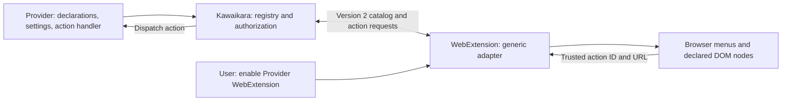
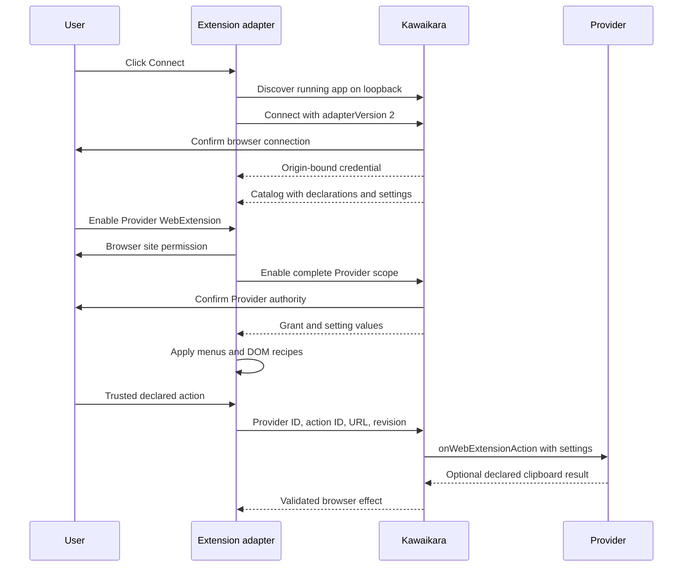
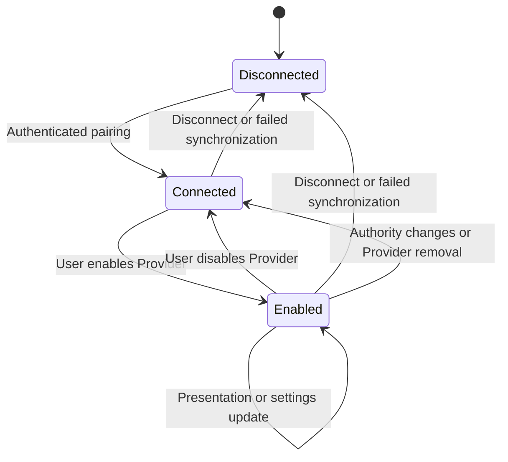
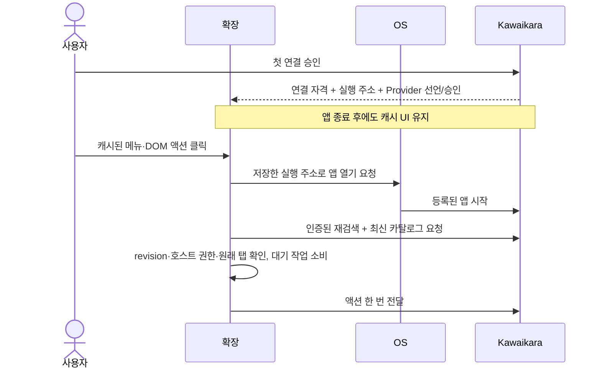

# Provider WebExtension 어댑터 계약

**구현 상태: version 2, Kawaikara 연결 전용 어댑터.** 사이트·Provider 목록,
DOM 선언·설정·실행 코드는 Kawaikara가 소유한다. 확장에는 통신, 계약 검증,
공통 설정 UI, 브라우저 메뉴·DOM 렌더러와 제한된 브라우저 효과 실행기만 들어간다.
기본 Provider 목록, 사이트별 selector, 공유 URL 생성, 연결 전 딥링크 실행은 없다.

## 책임과 구조



`ProviderManager`가 비활성 Provider까지 선언을 제공하고,
`WebExtensionBridge`가 연결·승인·동기화를 담당한다. `WebExtensionManager`는
Electron 승인창과 앱 동작을 연결한다. 네이티브 기능은 Platform, Electron 사용은
앱 계층의 독립된 책임이다. Provider의 사이트 코드를 확장에 복사하지 않는다.

## Provider 선언과 액션

Provider와 Bundle에 `web-extension` 권한을 선언하고 아래 내용을
`descriptors.webExtension`에 둔다. 호스트 범위는 Provider의 address에서 가져온다.

```json
{
  "version": 2,
  "actions": [
    "save-clip"
  ],
  "actionDefinitions": {
    "save-clip": {
      "title": "Save clip",
      "handler": "provider",
      "clipboard": true
    }
  },
  "settings": [
    {
      "id": "show-menu",
      "title": "Show save menu",
      "defaultValue": true
    }
  ],
  "contextMenus": [
    {
      "id": "save",
      "action": "save-clip",
      "title": "Save this clip",
      "contexts": [
        "page",
        "video"
      ],
      "when": "show-menu"
    }
  ],
  "domActions": [
    {
      "id": "player-tools",
      "event": "contextmenu",
      "trigger": ".player",
      "target": ".player-menu",
      "layout": "button-list",
      "itemClass": "player-menu-item",
      "placement": "append",
      "items": [
        {
          "id": "save",
          "action": "save-clip",
          "title": "Save this clip",
          "when": "show-menu"
        }
      ]
    }
  ]
}
```

액션은 고정된 세 종류가 아니라 Provider가 정의하는 ID다. `actionDefinitions`의
`handler`는 Kawaikara가 해석한다. `open`, `download`, `share-link`는 앱의 공통
처리기를 사용하고 `provider`는 해당 Provider 생성자의 정적
`onWebExtensionAction`으로 전달한다. 3rd-party는 새 액션을 추가해도 확장을
배포할 필요가 없다. 실제 코드는 Kawaikara에서 실행하며 Provider 화면을 열지 않아도 된다.

```ts
export class ClipProvider extends AbstractUrlProvider {
    protected readonly url = 'https://clips.example/';

    static async onWebExtensionAction(request: WebExtensionInvocation): Promise<WebExtensionResult> {
        if (request.action !== 'save-clip') throw new Error('Unknown action');
        // Run Provider-owned application logic here. This code stays in Kawaikara.
        return { clipboard: request.url };
    }
}
```

`contextMenus`는 브라우저 우클릭 대상·문구·순서를 정한다. link 항목은 링크 URL,
나머지는 페이지 URL을 전달한다. `domActions`에는 여러 삽입 규칙을 선언할 수 있다.
각 규칙은 ID, contextmenu/click 이벤트, trigger/target selector, 동영상 필요 여부,
클래스, 앞/뒤 삽입 위치와 항목을 지정한다. `when`으로 설정값에 따라 항목을 숨긴다.

현재 동적 설정은 boolean을 지원한다. DOM은 menu-item/button-list 공통 구조를
사용하며 일반 텍스트 노드로 생성한다. 임의 JavaScript·HTML·CSS·eval은 전달하지
않는다. 공통 렌더링 구조 자체를 늘릴 때만 확장 업데이트가 필요하다. 기존 계약의
사이트·DOM 위치·메뉴·설정·앱 액션 추가는 Provider 갱신으로 처리한다.

Provider 개수와 전체 카탈로그 바이트 수를 고정 제한하지 않는다. 전체 snapshot과
브라우저 자원에는 메모리·시간에 따른 한계가 있다. 같은 사이트의 여러 Provider도
각자의 권한으로 동작한다. 하나의 툴바 동작만 가장 구체적인 도메인과 ID 순서로 고른다.

## 연결과 사용 선택



1. Kawaikara를 실행하고 확장 옵션의 **Kawaikara 연결하기**를 누른 뒤 앱 승인창에서
   허용한다. 코드 복사는 필요 없다. 여러 프로필이나 검색 포트 충돌 시에는 고급의
   수동 코드 연결을 사용할 수 있다.
2. 연결 시 adapterVersion 2를 확인한다. 지원하지 않는 버전은 거부한다.
3. 앱이 보낸 Provider만 목록에 나타난다. 초기 상태는 꺼짐이다.
4. **<Provider> WebExtension 켜기**를 켠다. 브라우저 사이트 권한과 앱의 해당
   Provider 범위를 승인하면 그 Provider의 메뉴·DOM 액션·설정이 적용된다.
5. 설정 항목은 Provider 스키마로 자동 생성하며 값은 앱의 해당 브라우저 승인에
   저장한다. 동작별 승인 체크박스나 확장 자체 기본 기능은 만들지 않는다.
6. 끄면 메뉴·스크립트 등록·이미 추가된 DOM이 제거된다. 연결 해제나 앱 통신
   실패 감지 시 목록도 비워진다. 오프라인 동작이나 기본 목록 대체는 없다.

옵션 상단은 로드 완료·앱 연결·Provider 활성 수를 각각 표시한다. 배지는
LINK(앱 연결 필요), SET(Provider 켜기 필요), ON(활성 Provider 있음), !(오류)다.
현재 앱 프로필 하나에 브라우저 프로필 하나를 연결한다. 실행 중인 앱을 자동 검색해
인증된 IPv4 루프백으로 연결한다. 종료된 앱의 Native Messaging 자동 실행은 후속 설계다.
브라우저 사이트 권한 요청과 확인은 manifest의 선택 권한 선언에 맞춰
`http://*.host/*`, `https://*.host/*`를 각각 사용한다. `*://`로 합쳐 요청하면
Chrome이 manifest에 없는 권한으로 거부할 수 있다.

Provider를 켜기 전에도 설정 체크박스를 수정할 수 있다. 이 값은 옵션 페이지의 임시
선택이며 Provider를 켤 때 함께 제출된다. 브라우저·앱 승인 완료 전에는 메뉴가 생기지 않는다.

## 갱신·권한·수명



앱은 선언·승인·설정의 revision을 계산한다. 확장은 시작·사용자 조작·30초 알람에
조건부 동기화를 하고, 변경 없으면 304를 받는다. 콘텐츠 인스턴스의 사용 기한은
60초다. 브라우저 중단으로 감지가 지연될 수 있지만 실제 액션은 항상 실행 중인
앱의 검증을 거친다. 연결 실패 시 승인된 카탈로그와 UI 진입점은 캐시로 유지하며, 실제 실행 전 재연결한다.

기존 콘텐츠 렌더러에는 승인된 스냅샷을 직접 전달하고 즉시 적용 확인을 받는다.
응답하는 렌더러가 없는 탭에만 스크립트를 주입해, 중복 갱신이 방금 연 메뉴를
지우는 경쟁 상태를 방지한다. 메뉴 검색 재시도에서도 기존 노드를 보존해
키보드 포커스와 처리 중인 클릭을 끊지 않는다.

문구나 selector 갱신은 기존 승인으로 적용한다. 호스트·액션 처리기·클립보드 권한·
DOM 접근 여부·설정 ID 변경은 승인을 무효화한다. Bundle 교체는 최종 상태가 확정된
뒤 판정한다. Provider 삭제는 해당 승인을 제거한다. 설정 수정도 revision에 반영한다.

공유 계약은 `packages/site-api/src/WebExtension.ts`다. 확장의
`npm run sync:providers`는 이제 **계약만 복사**하며 Provider 데이터는 넣지 않는다.
version 1의 기본 목록·로컬 승인 모델은 제거했다. 기존 연결 자격은 재사용할 수
있지만 승인 키가 바뀌므로 새 계약의 Provider는 다시 켜야 한다.

서버는 127.0.0.1의 Host·토큰·확장 origin·현재 URL·revision·Provider 승인을
검증한다. 설정 변경은 확장 옵션에서만 요청한다. 콘텐츠는 최상위 프레임의 실제
탭 URL을 사용하며 합성 클릭은 실행하지 않는다. 앱은 선언된 clipboard 권한이
있을 때만 텍스트 복사 결과를 반환할 수 있다. 실행 코드를 응답하지 않는다.


앱은 기존 인증 포트를 유지하고 `43821–43830` 중 빈 루프백 포트 하나에 검색
리스너를 연다. `/v1/discover`는 프로토콜·버전·루프백 주소만 반환하고 토큰이나
Provider 목록은 노출하지 않는다. `/v1/connect`는 일치하는 확장 Origin/Host 검사,
본문 제한, 동시 요청 차단, 10초 승인창 속도 제한을 적용한다. 실제 앱 승인 후에만
토큰을 발급한다. 취소·연결 해제·앱 종료 중 대기하던 승인은 자격을 복원할 수 없다.
같은 확장을 재연결하면 Provider 승인을 보존하고, 다른 확장을 연결하면 기존 승인을
제거한다. 모든 검색 포트가 점유되면 수동 연결은 계속 가능하다. 여러 앱이 검색되면
기존 연결 주소를 우선하고, 선택할 수 없으면 임의로 연결하지 않고 안내한다.
일반 웹 페이지에는 CORS 접근을 허용하지 않는다. 로컬 프로세스는 확장 헤더를
위조할 수 있으므로 검색 응답을 OS 수준의 신원 인증으로 취급하지 않는다.

전송 URL의 /v1/ 이름은 유지하며 discover/connect/pair/catalog/grant/revoke/settings/invoke/disconnect를
사용한다. URL의 버전과 카탈로그 계약 version 2는 별개다. 요청 ID 중복을 차단하며
불확실한 실행 요청은 자동 재시도하지 않는다.

## 검증

연결 전 빈 상태, Provider 토글, 동적 설정, 임의 액션 ID, 화면 활성화 없는 정적
Provider 핸들러, 권한 변경·해제, 501개 중첩 Provider, 512KiB 초과 목록을 테스트한다.
격리 Chromium에서는 코드 없는 자동 연결·활성화 전 설정 변경과 앱의 YouTube/CHZZK 선언으로 실제 DOM 삽입·키보드/마우스 실행,
설정에 따른 DOM 제거/복구·클립보드·갱신을 검증한다. 이 임시 프로필의 브라우저
권한창은 미리 허용하므로 실제 사용자 권한창과 Firefox 런타임은 별도 확인 대상이다.


## 첫 연결에 실행 경로를 연결하기

앱에서 승인한 `connect`/`pair` 응답은 `launchUrl: kawaikara://bridge/wake`를 포함한다.
확장은 이 주소만 허용하고 연결 자격과 함께 저장한다. 실행 파일 위치는 앱이 시작할 때
등록하는 OS 프로토콜 핸들러가 해석한다. 무설치 앱도 핸들러 등록이 필요하며 이동했거나
등록을 지원하지 않는 개발 실행 환경이면 앱을 직접 실행해야 한다. 기존 연결은 한 번
재연결해야 실행 정보가 저장된다. 실행 주소는 신원 증명이 아니므로 다른 프로필이 열리면
자동 신뢰하지 않고 기존 연결 토큰의 HMAC 증명으로 재검색 결과를 검증한다.

앱이 꺼져도 캐시된 Provider 메뉴·DOM 버튼을 유지한다. 사용자 클릭 시 내부 실행 대기
탭을 열고 저장한 주소로 실행을 요청한다. 브라우저 확인창 승인은 생략할 수 없으며,
자동 실행이 막히면 같은 탭의 실행 버튼 또는 수동 실행을 사용한다. 주기적 갱신은 앱을
실행하지 않는다. 설정 변경은 계속 앱이 검증·저장한다.



대기 작업은 확장 전용 저장소에서 최대 2분 유지하며 워커 재시작에도 이어진다.
대기 탭에는 불투명 ID만 담고 90초 동안 재연결을 시도한다. 취소·시간 초과·연결 해제 시
삭제한다. 탭을 닫으면 폴링이 멈추며 앱이나 워커 시작 시 자동 재실행하지 않는다.
Provider/설정 revision 또는 원래 탭이 바뀌면 재클릭을 요청한다. 실행 응답 유실은
자동 재시도하지 않는다.


## 앱의 Extension 사용하기 버튼

설정의 **Extension 사용하기**는 2분간 유효한 일회용 승인을 만들어 기본 브라우저에
`http://127.0.0.1:<port>/extension-connect#<ticket>`을 연다. 설치된 확장의 전용
콘텐츠 스크립트가 이를 감지한다. 워커는 브라우저가 제공한 최상위 프레임 URL과
실제 탭을 확인한 후 `connect`에 ticket을 전달한다. 첫 연결·동일 브라우저 재연결은
앱 버튼에서 받은 승인으로 처리하고, 다른 브라우저 교체는 별도 확인한다.
연결 후 확장 설정을 열어 Provider와 사이트 권한을 선택하게 한다. 코드 복사는 고급
옵션으로 유지한다. 설치되지 않았거나 다른 브라우저에 설치된 경우 페이지에서 안내한다.

공개 연결 페이지는 자격을 포함하지 않고 스크립트·프레임·referrer를 차단한다.
일회용 승인은 fragment에만 있으며 처리 후 현재 방문 기록에서 지운다. 페이지에
최종 연결 토큰을 반환하지 않는다. 만료·사용·교체된 ticket은 거부하고, 연결 해제와
종료 시에도 무효화한다. 연결 창을 열기만 해서는 기존 자격을 해제하지 않는다.
확장 ID를 고정하지 않아 개발용 압축 해제 설치도 지원한다.


### Development runtime and adapter reload diagnostics

Web Extension controls are in **Advanced** preferences. Unpackaged macOS/Linux does
not register the generic Electron bundle as the protocol client. The bridge advertises
`launchUrl: null` in pairing replies and catalogs, replacing old cached launch hints.
The authenticated `POST /v1/wake` focuses an already running app without launching an
OS handler. Offline development requires manual startup (`pnpm dev`) or a packaged build.

Options and workers negotiate `uiVersion: 1`. Incompatible/missing response fields
produce reload instructions instead of an undefined `.find` error. The loopback page
loads a same-origin status timer: after ten seconds without the packaged content script,
it explains how to reload the extension and retry. Its status script cannot pair or read
credentials. Reloading an unpacked extension and reopening old options/onboarding tabs
is required after updating its manifest or worker.


### Preferences UI and instance identity (0.6.3)

Supported browsers are Google Chrome and Mozilla Firefox only. After successful app-initiated
pairing, the worker replaces the originating onboarding tab with its runtime-generated
`options.html` URL; it no longer opens a second tab. Failed pairing stays on the original page.

The preferences UI uses React and the same KawaiUI Panel/Button/Switch/Input/Badge components
as Kawaikara. Provider cards show domain and capability tags, searchable by name/ID/domain.
Connect and Disconnect are mutually exclusive. Green/yellow/red badges include text for
connected, checking/offline, and unpaired states. The modal uses native dialog focus handling.

Authenticated catalogs optionally include `desktop` (name, version, channel, runtime,
appPath and a hash-based profileId). Public discovery does not include this data. The modal
shows cached identity explicitly when offline; old apps without metadata show an update hint.
Credentials remain in the worker and never appear in the preferences response or DOM.
